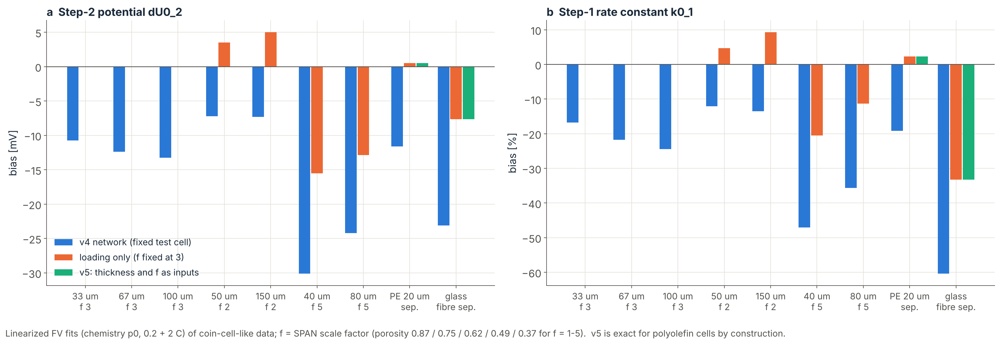

# Cell geometry in the two-curve tool

Status 2026-11-03 (night): step 0 (how much the network's fixed geometry biases the fitted parameters) done; real-cell
resistance conversion added; step 1 (which geometry inputs are needed) done; network v5 (cathode thickness and SPAN
scale factor as inputs, polyolefin separator fixed) IMPLEMENTED and smoke-tested, NOT trained: its FV design (window)
and training run on Grace.

## The problem

The chemistry network (v4, chem_v4_warm_salt_s0) and so the tool are trained for one cell, the Simanjuntak test cell:
100 um cathode with a low SPAN fraction (eps_SPAN 0.0945, porosity 0.87, 0.77 mg S/cm2 in the model) and a 618 um
glass-fibre separator (porosity 0.89, Bruggeman exponent 1).  Literature coin cells have 1-3 mg S/cm2, denser cathodes
and 25 um polymer separators.  Until now we assumed that w_S and Z absorb the difference and compared parameters only
within a paper.

## Step 0: known-truth test with other geometries

`scripts/lispan_geometry_bias.py` generates FV discharges of a cell with another geometry and a known chemistry,
converts them to specific capacity and specific current like literature data, and fits them with the network exactly
like SPAN-DB cells.  The fitted parameters minus the truth are the bias caused by the geometry alone.

    python scripts/lispan_geometry_bias.py --workers 2                                   # 7 geometries x 4 chemistries
    python scripts/lispan_geometry_bias.py --geoms celgard coin_mid coin_high --Z 0.005 --json results/lispan/geometry/bias_0.2+2_Z50.json

Geometry transform (all per-volume SPAN quantities scale with the SPAN fraction, so the chemistry per chain is the
same): cathode thickness L_cat; eps_SPAN = f x 0.0945, with eps_CB, the chain concentrations (c_init, c_ref) and the
specific surface a_SPAN0 scaled by f; separator thickness, porosity and Bruggeman exponent.  Same specific current =
same C-rate.  Truth: w_S = 1, chemistries p0 (nominal), litHao, litChen, litSpan300, d = 0, Z = 20 Ohm cm2 (and 50).
Calibration 0.2 + 2 C, blind predictions at 0.5 and 1 C.

| geometry | cathode | separator | loading [mg S/cm2] | porosity |
|---|---|---|---|---|
| ref | 100 um, f = 1 | 618 um glass fibre | 0.77 | 0.87 |
| celgard | 100 um, f = 1 | 25 um, porosity 0.41, beta 2.33 (MacMullin ~8, assumed) | 0.77 | 0.87 |
| thick2x | 200 um, f = 1 | glass fibre | 1.53 | 0.87 |
| dense3 | 67 um, f = 3 | glass fibre | 1.54 | 0.62 |
| dense4 | 75 um, f = 4 | glass fibre | 2.30 | 0.49 |
| coin_mid | 67 um, f = 3 | Celgard-type | 1.54 | 0.62 |
| coin_high | 75 um, f = 4 | Celgard-type | 2.30 | 0.49 |

Results (`results/lispan/geometry/bias_0.2+2.json`, `bias_0.2+2_Z50.json`): mean bias over the 4 chemistries (spread
between chemistries in brackets); Z as converted to the real cell (below).

| geometry | misfit [mV] | w_S [%] | dU0_2 [mV] | dU0_3rel2 [mV] | b_12 [%] | k0_1 [%] | d [mV] | Z real cell [Ohm cm2] | blind pred. [mV] |
|---|---|---|---|---|---|---|---|---|---|
| ref | 0.9 | 0.0 (0.0) | +0.8 (1.1) | -1.0 (2.7) | 0.0 (0.2) | +3 (3) | -0.4 (0.9) | +0.4 | 0.6 |
| celgard | 3.0 | +0.1 (0.3) | -1.3 (1.7) | +0.8 (8.0) | -2.8 (0.4) | -3 (5) | -2.5 (0.7) | -20 | 2.1 |
| thick2x | 6.0 | -0.5 (0.7) | +15.5 (3.6) | +2.0 (10) | +4.1 (2.5) | +83 (40) | -6.8 (6.6) | +35 | 7.1 |
| dense3 | 4.0 | -0.3 (0.2) | -6.1 (7.3) | -7.4 (5.6) | +5.7 (0.5) | -16 (21) | +14.7 (5.1) | +16 | 4.0 |
| dense4 | 16.7 | -16 (11) | +76 (50) | +106 (108) | +8 (10) | +373 (71) | +18 (14) | +37 | 37 |
| coin_mid | 3.3 | +0.1 (0.3) | -8.4 (3.0) | -2.9 (6.4) | -1.9 (0.5) | -17 (8) | +1.5 (2.1) | -10 | 2.7 |
| coin_high | 3.6 | +0.1 (0.4) | -15.0 (4.0) | -7.0 (8.7) | -0.6 (1.1) | -29 (7) | +6.1 (4.3) | -3 | 3.2 |

What it shows:
1. **The bias is invisible in the fit.**  Except for the extreme dense4 cell (thick glass fibre with a dense
   cathode), the misfit stays at 3-7 mV and the blind predictions at 2-7 mV.  A good fit does not prove the geometry
   is harmless.
2. **w_S is not a geometry effect** (< 1 % for every coin-like geometry).  The w_S of 1.2-1.4 found for literature
   cells on an S basis is therefore the cell delivering more than the model's 1254 mAh/g S (6 e- per PAN-S4-PAN chain),
   not a transport factor as assumed before (docs/SPANDB_FITS.md corrected).
3. **Z carries the loading.**  The fitted Z multiplies the network's current density, not the real one.  With the
   conversion Z_cell = Z_fit m_S,model / (w_S x loading) (`two_curve.z_cell`, loading in the data's mass basis), the
   remaining bias is -3 to -10 Ohm cm2 for coin cells (+16 to +37 for glass-fibre cells with thick or dense cathodes),
   the same for a true Z of 20 or 50 Ohm cm2.  Without the conversion the fitted Z is off by the loading ratio (x2-3),
   and high-loading cells hit the Z box edge (500 Ohm cm2) for that reason alone.
4. **Potentials and kinetics move by 10-30 mV and 20-30 %** for coin-like cells (dU0_2 -8 to -15 mV, k0_1 -17 to
   -29 %, d +2 to +6 mV); thick or dense cathodes with a thick separator move them more (k0_1 up to +80 %).
5. **Within one geometry the bias is nearly common to all chemistries** (spread between the four chemistries: dU0_2
   3-4 mV, d 2-4 mV, k0_1 7-8 %, b_12 <= 1 %, Z ~1 Ohm cm2 for coin cells), which is why comparisons within a paper
   hold.  Across papers, differences of about 10-20 mV in the potentials and a factor ~1.3 in k0_1 can be geometry.

## Real-cell resistance (added)

`two_curve.z_cell(Z_fit, w_S, loading_mg_cm2, params)`; `report/spandb/make_spandb_figures.py` writes it for the
described cells with a reported loading (numbers_<tag>.json, "z_cell_described"; 33 of 41 cells in the 95-paper run).
Example: Zuo 2024 (8.4 mg SPAN/cm2) fits at the Z box edge (~460 Ohm cm2 in network units) but is 88-94 Ohm cm2 for
the real cell; Shi 2023a (5.2 mg S/cm2) 55-77 Ohm cm2.  Comparisons within a paper are unchanged (same loading).

## Step 1: which geometry inputs does the network need?

### What SPAN-DB reports (`scripts/lispan_spandb_geometry.py`, 120-paper snapshot, 113 fitted cells)

Sulfur loading for 92 cells (liquid cells: median 0.95, p90 2.0, max 5.7 mg S/cm2), cathode thickness for 17,
porosity for 1.  Separator known for 86: polyolefin almost always (Celgard 2400 20, 2325 17, other Celgard 14, 2500 6,
PP / PE 12), glass fibre 1 (the Simanjuntak cell itself), solid electrolytes 12, gels / membranes 4.  The thickness
reports imply SPAN scale factors f of 4.5-8.7 (porosity < 0.45, some impossible: thickness or loading misreported).
Output: `results/lispan/geometry/spandb_geometry_v4_120.json` (per cell: loading and its source, thickness, f,
separator class with nominal catalogue values).

### Which combinations matter (`scripts/lispan_geometry_scaling.py`, FV only, chemistry p0, 0.2 / 1 / 2 C)

Members of a group are compared with the first one at equal specific capacity; "after d + Z" is what is left after
the best common offset and series resistance (what the tool absorbs without touching the chemistry parameters).

| group | finding |
|---|---|
| separator, same effective length L_sep / porosity^beta (25 um Celgard, 180 um at 0.90, 100 um at 0.50 ...) | <= 2 mV after d + Z: the effective length is the variable |
| separator, other effective lengths (61 - 694 um) | 0.7 - 3.6 mV after d + Z up to 363 um; the 618 um glass fibre 10 mV |
| cathode thickness 33 - 133 um at f = 3 | 0.4 - 1.9 mV after d + Z (thickness acts as a resistance), end capacity -3.5 to -11 % at 2 C |
| same loading, different f (1.53 and 3.07 mg S/cm2) | 1.8 - 9.5 mV after d + Z, grows with f |

### Parameter bias of reduced networks (`scripts/lispan_geometry_reduction.py`, FV only)

The network that knows only part of the geometry is emulated with the FV solver: Gauss-Newton fit (FD Jacobian,
3 iterations) of FV data from the true geometry with FV curves of the reduced geometry, same 8 parameters and rates as
SPAN-DB (0.2 + 2 C).  Check: the "ref" reduction (= the v4 network geometry) on the coin_67_f3 cell gives dU0_2
-12.4 mV, k0_1 -22 %, d +4.4 mV, misfit 3.3 mV; the real v4 network on the same cell (step 0, coin_mid, p0) gave
-13.1 mV, -23 %, +4.6 mV, 3.3 mV.  So the step can be studied without training networks.

Bias (chemistry p0; litHao in brackets where run).  ref = v4 network cell; load_f3 = network knows the loading only
(f fixed at 3, polyolefin separator); sep_fixed = cathode exact, separator polyolefin (= v5 for non-polyolefin data).

| data cell | network | misfit [mV] | dU0_2 [mV] | dU0_3rel2 [mV] | b_12 [%] | k0_1 [%] | d [mV] |
|---|---|---|---|---|---|---|---|
| 33 um, f 3, Celgard | ref | 3.3 | -10.7 | -5.2 | -1.5 | -17 | +3.1 |
| 67 um, f 3 | ref | 3.3 | -12.4 | -4.9 | -1.4 | -22 | +4.4 |
| 100 um, f 3 | ref | 3.3 | -13.2 | -4.7 | -1.4 | -24 | +4.5 |
| 50 um, f 2 | ref / load_f3 | 3.1 / 0.3 | -7.2 / +3.5 | -1.8 / +3.4 | -2.1 / -0.6 | -12 / +5 | +0.7 / -2.2 |
| 150 um, f 2 | ref / load_f3 | 3.1 / 0.6 | -7.3 (-6.4) / +5.0 (+3.8) | -2.8 / +2.1 | -2.3 / -0.7 | -14 (-26) / +9 (+9) | -0.6 / -4.0 |
| 40 um, f 5 | ref / load_f3 | 4.3 / 1.5 | -30.1 (-19.5) / -15.5 (-10.4) | -21.8 / -17.0 | +1.4 / +2.6 | -47 (-41) / -21 (-14) | +18.1 / +10.6 |
| 80 um, f 5 | ref / load_f3 | 4.6 / 2.7 | -24.2 / -12.8 | -30.2 / -24.1 | +0.8 / +2.2 | -36 / -11 | +11.2 / +6.8 |
| 67 um, f 3, PE 20 um / 0.40 | ref / sep_fixed | 3.3 / 0.1 | -11.6 / +0.5 | -5.3 / -0.2 | -1.4 / 0.0 | -19 / +2 | +3.7 / -0.6 |
| 67 um, f 3, glass fibre 260 um | ref / sep_fixed | 3.5 / 1.1 | -23.1 / -7.6 | -4.8 / -0.1 | -0.2 / +1.4 | -60 / -33 | +20.1 / +12.5 |

Conclusions:
1. **The cathode density (f, porosity) is the dominant geometry variable**: at f = 5 (porosity 0.37) the v4 geometry
   biases dU0_2 by -20 to -30 mV and k0_1 by -40 to -47 %; knowing the loading with f fixed still leaves -10 to -15 mV.
   So f must be an input.
2. **Thickness at fixed f** shifts the parameters only a little (dU0_2 -10.7 / -12.4 / -13.2 mV for 33 / 67 / 100 um)
   but sets the current density and the transport limit (capacity at high rate); with f it fixes the loading.
3. **Polyolefin separators are interchangeable** (PE 20 um vs Celgard 25 um: <= 0.6 mV, 2 %).  A glass-fibre
   separator is not (k0_1 -33 %, d +12.5 mV): 1 SPAN-DB cell, flagged instead of modelled.
4. The chemistry dependence is small (p0 vs litHao within a few mV and ~10 %), as in step 0.

## Network v5 (implemented 2026-11-03, not trained)

**Inputs:** C-rate (per g S, 0.08 - 3 C), the 5 chemistry inputs of the v2 box, ln L_cat (20 - 200 um) and f (1 - 5,
porosity 0.87 - 0.37).  Separator fixed: 25 um polyolefin, porosity 0.41, beta 2.33 (`geometry.SEP_POLYOLEFIN`).
**Transport domain** (`geometry.in_domain`): Theta = I L_cat / porosity^1.5 <= 0.03 A/m and loading <= 6 mg S/cm2.  FV
corners: Theta 0.015 - 0.026 keeps the salt above 650 mol/m3; Theta 0.078 -> 220, 0.090 -> 59 (depleted, transport
collapse).  A literature cell at 2 mg S/cm2 and f = 4 is inside up to ~3 C (Theta 0.0097 at 2 C); 4 mg S/cm2 up to ~1.5 C.

**Physics per row** (`src/dfn_pinn/lispan/geo_pinn.py`): species in reference units (the chemistry per chain does not
depend on f: activities, a / c_S4,0 and the extent equations are unchanged - unit test), true surface a = f a_SPAN0
(eps_e / eps_e0)^1.5, Li2S volume x f, I = ONE_C r f L / 100 um, kappa_s = kappa_SPAN (f eps_SPAN)^1.5, hard charge
inventory with the per-row target Q / (2 F L f c_S4,0) (exact, unit test).  Electrolyte networks on a logical
coordinate with the interface fixed at Y = 0.8 (chain-rule factors in the residuals); salt as c0 exp(s(z) dev) because
dense cathodes concentrate the salt up to ~2x as Li2S fills the pores (FV at f = 5: 650 - 2090 mol/m3), s(z) a physics
estimate.  Residual names and groups are those of v4 (`geo_residuals`), so the v4 training loop and recipe are reused.

**Window:** ln(r t_cut) = P6 (the v3 window, kept) + a polynomial correction in (ln r, theta_hat, gamma_hat).  On the
first 108 FV points of the design the v3 window alone is off by -6.5 to +12.7 % (worst: 200 um at 3 C); a degree-2
correction brings it to 3.4 % (held out 8 %, few points).  The full design picks the degree by held-out error.

**FV design** (`scripts/lispan_geo_design.py`): corners of the 7-d box (128), centre, Latin hypercube of 900 -> 986
conditions inside the loading limit x 7 rates inside the transport domain = 6569 discharges, ~6 s each (~11 CPU h):
`slurm/lispan_geo_design_array.slrm` (40 shards, ~15 SU), then `python scripts/lispan_geo_design.py fit`.
**Evaluation:** 8 chemistries (p0-p3, p5-p7, litHao) x 4 geometries (30 um f 2, 60 um f 4, 100 um f 1.5, 140 um f 3) x
0.1 / 0.5 / 2 C = 96 references at 40 / 20 cells (`data/lispan_geo_refs/lispan_geo_design_v5/`, built in the sandbox,
5-15 s each); select = p0-p3 on g1 and g3 (24), the rest test.

**Training:** `configs/lispan_geo_v5.json` (v4 recipe, 300 000 steps, freeze at 80 000), variants
`configs/lispan_geo_variants_v5.txt` (2 seeds from scratch, 2 warm starts from chem_v4_warm_salt_s0 with zero geometry
columns), `slurm/lispan_geo_array.slrm` (--time=168:00:00).  Sandbox: ~1.0 - 1.5 s per step (v4 1.1 - 1.2), so
300 000 steps ~110 - 125 h on one Grace core, 4 runs ~450 - 500 SU.  Smoke test: 40 steps, loss 1054 -> 183, no
skipped batch.  Tests: `tests/test_lispan_geo.py` (5).

**Gate (proposed):** as v4 (outside-cliff test mean < 2 mV, every test case < 5 mV, cliff shift < 1 %) on the 96
geometry cases; then the known-truth test of step 0 with v5 (the geometry bias must fall to the network floor) and a
SPAN-DB refit with each cell's geometry.

**Data side (to do):** thickness from the loading when only the loading is reported needs f: use the reported
thickness when present (then f = loading / (0.767 x L / 100 um), clipped to [1, 5] with a flag), otherwise a prior
f = 3 +- 1 (porosity 0.62 +- 0.13) and refit at f = 2 and 4 to add the geometry spread to sd_total; cells without a
loading take a typical 1.5 +- 0.7 mg S/cm2 the same way.  Glass-fibre and solid-electrolyte cells are flagged.

## Next steps

1. Owner on Grace: `sbatch slurm/lispan_geo_design_array.slrm` (~30 min), `python scripts/lispan_geo_design.py fit`,
   copy `configs/lispan_geo_design_v5.json` back; check the window error; then `sbatch slurm/lispan_geo_array.slrm`.
2. Meanwhile: geometry in the two-curve tool (TwoCurveFit with geometry, prior / spread on f) and in
   `lispan_spandb_fit.py` (per-cell loading, thickness, separator flag).
3. After training: gate, known-truth test with v5 at the step-0 geometries, SPAN-DB refit, comparison with v4.

## Files

- `scripts/lispan_geometry_bias.py` - the test (geometry transform `geometry()`, table GEOMS).
- `results/lispan/geometry/bias_0.2+2.json`, `bias_0.2+2_Z50.json` (+ .log) - results.
- `src/dfn_pinn/lispan/two_curve.py` - `z_cell`.
- `src/dfn_pinn/lispan/geometry.py` - cell geometry (cell_params, polyolefin_cell, loading, transport domain).
- `scripts/lispan_spandb_geometry.py` - geometry reported in SPAN-DB -> `results/lispan/geometry/spandb_geometry_<tag>.json`.
- `scripts/lispan_geometry_scaling.py` -> `results/lispan/geometry/scaling_p0.json`; `scripts/lispan_geometry_reduction.py`
  -> `reduction_p0.json`, `reduction_litHao.json`; figure `report/geometry/make_reduction_figure.py` -> `geo_reduction.png`.
- Network v5: `src/dfn_pinn/lispan/geo_pinn.py`, `scripts/lispan_geo_design.py`, `scripts/lispan_geo_train.py`,
  `configs/lispan_geo_v5.json`, `configs/lispan_geo_variants_v5.txt`, `slurm/lispan_geo_design_array.slrm`,
  `slurm/lispan_geo_array.slrm`, `tests/test_lispan_geo.py`.
