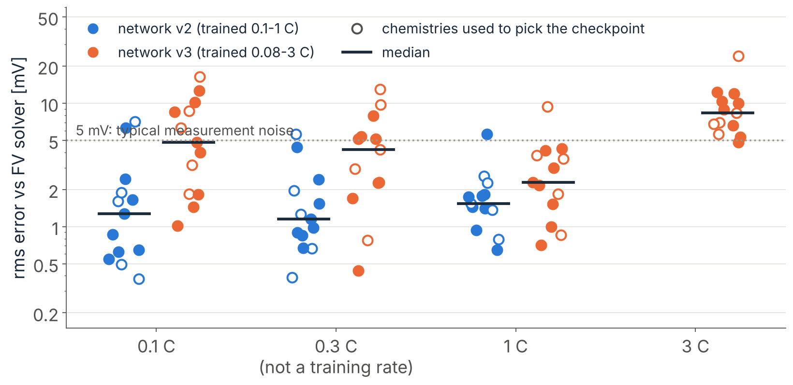
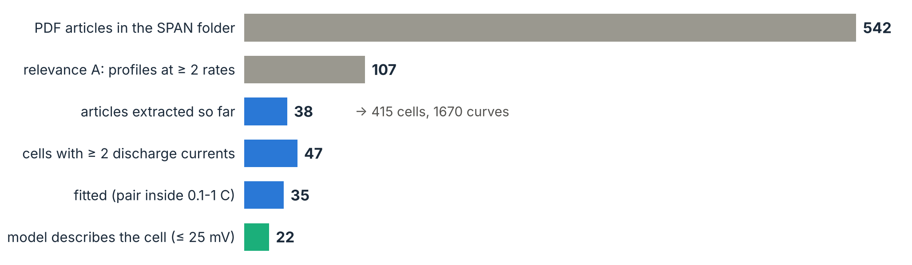
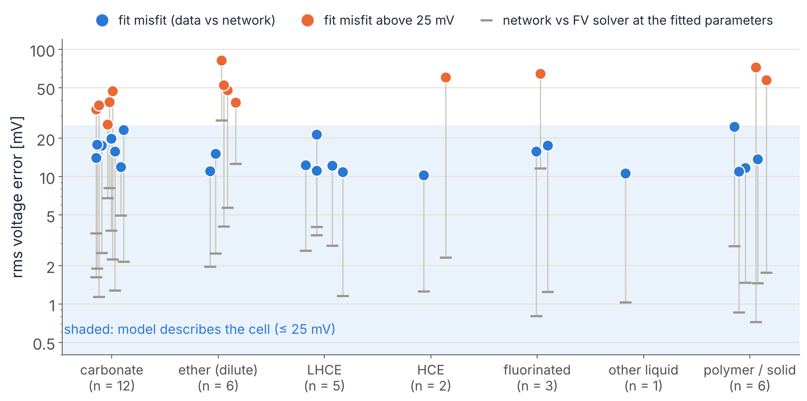
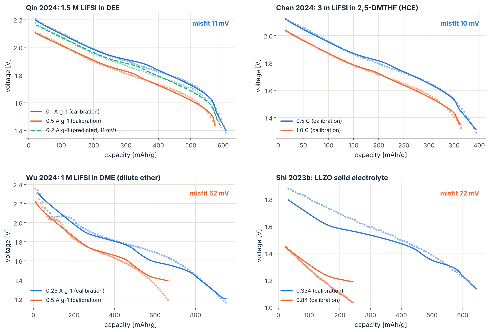
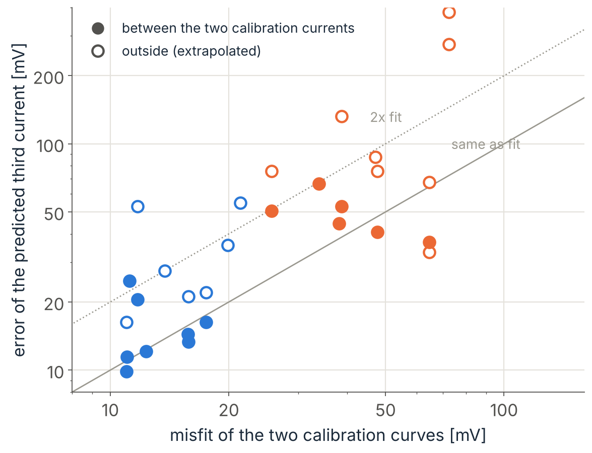
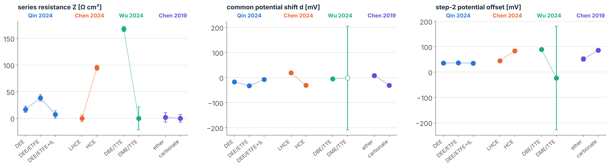

<!-- Markdown export of the Claude Doc "PINN for Li-SPAN: Technical Report from DFN to SPAN-DB" (https://claude.ai/artifact/79SsxzrqLAYC3e1RVSuppn), exported 2026-10-30. The Claude Doc is the editable original; figures are linked to their files in this repository. -->

# PINN for Li-SPAN: Technical Report from DFN to SPAN-DB

Oct 30, 2026 · @Carlos

## 0. Reading guide and executive summary

In eight weeks (September 11 to October 30, 2026) the project went from a physics-informed neural network (PINN) that could not reproduce a lithium-ion model (23 mV error) to a trained network that fits published lithium–SPAN discharge curves in about one minute. That network was applied to 35 literature cells extracted by AI agents into a database (SPAN-DB); the continuum model describes 22 of them within 25 mV.

### How to read this report

- **Order.** Parts I–III give the chemistry and the mathematics. Parts IV–X follow the work in time: the DFN model of a lithium-ion cell, the Li-SPAN model, the parametric network and the fitting tool. Parts XI–XII describe SPAN-DB and its first results. Parts XIII–XV cover applications, limitations and the plan to finish the project. The appendices hold a glossary, the symbols, a table of key numbers and a file map.
- **Every section opens with its result.** Background and reasoning follow.
- **Status words** are used consistently: DONE (finished and checked), RUNNING (in progress on a computer), PROPOSED (planned, not started), OPEN (a question without an answer yet).
- **Units.** Voltage errors are root-mean-square (rms) differences in millivolts (mV) between two curves, unless “max” is written. Capacities are in mAh per gram of the stated mass basis: sulfur (S), SPAN composite, or electrode. A C-rate is the current that would discharge the nominal capacity in one hour (1 C); “0.1 C” is ten times slower.
- **Two kinds of reference.** “FV” is our finite-volume solver: the numerical reference that solves the model equations directly. “Data” means measured curves from papers. A network error is always measured against FV; a fit misfit is always measured against data.
- **For AI tools reading this text.** Terms are defined in Appendix A and symbols in Appendix B. Every number carries its unit and, where possible, the file it comes from (Appendix D). Statements labelled “interpretation” are hypotheses, not measurements.

### People and tools

| Role | Who |
| --- | --- |
| Project lead | Carlos Guerrero (Balbuena group, Department of Chemical Engineering, Texas A&M University) |
| Advisor | Dr. Perla Balbuena |
| Undergraduate presentations | Joshua Tran |
| Code and analysis | Claude (Anthropic AI), from October 3; Codex (OpenAI AI) before that |
| Computing | Cloud sandbox (2 CPU cores), the owner’s PC, and the TAMU HPRC Grace cluster (single-core job arrays) |

### The work in ten results

| # | Stage | Result | Status |
| --- | --- | --- | --- |
| 1 | PINN for the DFN model, LG M50 cell vs PyBaMM | 0.25 mV rms over a 1 C discharge (first attempts: 23 mV) | DONE |
| 2 | DFN inverse problem and synthetic aging | Three parameters within 0.6 %; aged-cell parameters within 0.2–1.5 %; found that PyBaMM’s stress-induced diffusion caused a fake “negative resistance” | DONE |
| 3 | Li-SPAN finite-volume solver (rebuild of Simanjuntak et al. 2024) | Reproduces the paper’s curves and capacities within a few percent | DONE |
| 4 | Li-SPAN PINN, one rate | 0.16 mV (0.1 C) and 0.23 mV (1 C) from the solver | DONE |
| 5 | Identifiability | Kinetic constant and potential of steps 2–3 are inseparable; two currents (slowest and fastest) are needed | DONE |
| 6 | Parametric network v2 (any rate 0.1–1 C, any chemistry in a box) | 1.4 mV median from the solver, below 5 mV measurement noise | DONE |
| 7 | Two-curve fitting tool | 8 parameters in 35–70 s; agrees with the solver’s optimum (45 of 47 parameters within 1 sd) | DONE |
| 8 | SPAN-DB built by AI agents | 542 papers triaged, 38 extracted: 415 cells, 1670 curves with provenance | RUNNING (73 + 156 papers left) |
| 9 | Fits of literature cells | 35 cells fitted; 22 described within 25 mV; LHCE 5 of 5, dilute ethers 2 of 6 | DONE (first pass) |
| 10 | Networks for higher rates (to 3 C) | v3: 4.8 mV median; v4 with an exact charge balance training on Grace | RUNNING |

### Project timeline (past events, newest first)

| Dates (2026) | Event |
| --- | --- |
| Oct 30 | SPAN-DB cells fitted; group-seminar deck; v4 network submitted to Grace |
| Oct 27–29 | Two-curve tool built and validated; v3 network (0.08–3 C) trained and analysed |
| Oct 24–28 | SPAN-DB pilot and batches 1–10 (separate conversation in this project) |
| Oct 22–27 | Chemistry network: v1 and v2 trained on Grace |
| Oct 18–23 | Rate network (Phase 3a): four training waves on Grace |
| Oct 14–16 | Phase 1 identifiability study; Phase 2 literature pilots (Chen 2019, Ma 2026, Hao 2025) |
| Oct 10–13 | Chemistry study of SPAN300/320/500 (Wang et al., Nat. Mater. 2026); advisor asks what the work is for |
| Oct 6–9 | Li-SPAN solver, Li-SPAN PINN at 0.1 C and 1 C, three seeds each; draft manuscript |
| Oct 3–6 | Redesigned DFN PINN: 0.25 mV; inverse and aging studies |
| Sep 11–Oct 3 | First attempts (Codex): the DFN PINN never converged (best 23 mV) |

## Part I. Lithium–sulfur and SPAN chemistry, and why a model is needed

SPAN cathodes store charge by reducing sulfur that is covalently bound to a polymer. Their discharge curves at several currents contain information about thermodynamics, kinetics and resistance, but only a physical model can separate those contributions. This part gives the chemistry needed to read the rest of the report; it is general background, not a result of this project.

### I.1 The lithium–sulfur couple

The overall reaction of a lithium–sulfur cell is the reduction of elemental sulfur to lithium sulfide:

```latex
\mathrm{S_8 + 16\,Li^+ + 16\,e^- \;\longrightarrow\; 8\,Li_2S}
```

Two electrons per sulfur atom give a theoretical specific capacity of 1672 mAh per gram of sulfur, about ten times the practical capacity of a lithium-ion cathode per gram of active material. The average voltage is about 2.1–2.2 V against lithium metal.

In a classical Li–S cell with an ether electrolyte, S₈ is reduced in stages through soluble lithium polysulfides Li₂Sₙ (n = 8, 6, 4) before the insoluble Li₂S₂/Li₂S forms. The dissolved polysulfides diffuse to the lithium anode and react there (the “shuttle”), which causes self-discharge, low coulombic efficiency and capacity fade. Sulfur and Li₂S are also electronic insulators, and the cathode expands by roughly 80 % in volume on full lithiation.

### I.2 What SPAN is

SPAN (sulfurized polyacrylonitrile) is made by heating polyacrylonitrile (PAN) with sulfur, typically at 300–550 °C. PAN dehydrogenates and cyclizes into a conjugated, partly aromatic backbone, and sulfur ends up covalently bonded to it as short chains. The composite typically holds 38–48 wt% sulfur (SPAN-DB range of reported values in the fitted cells: 29–48 wt%).

Because the sulfur is bound and the chains are short, SPAN avoids long-chain polysulfides in carbonate electrolytes. The conversion is solid–solid, there is no shuttle, and SPAN cycles in the same carbonate electrolytes as lithium-ion cells. Three features matter for this project:

- **First-cycle activation.** The first discharge sits at a lower voltage (around 1.6–1.8 V for part of the capacity) and has extra, partly irreversible capacity. From the second cycle on, the profile is a single sloping region from about 2.2 V to 1.6 V followed by a drop to the cut-off. Any modeling of SPAN must decide whether to include cycle 1; we exclude it.
- **Synthesis temperature changes the sulfur chains.** In Wang et al. (Nat. Mater. 25, 791, 2026; Balbuena group co-authors), higher synthesis temperature gives shorter chains. Our fits of their SPAN300/320/500 curves (cycle 2, C/10) found the three step potentials of SPAN500 lower than those of SPAN300 by 118, 68 and 234 mV.
- **The electrolyte matters.** In solvating ethers (DOL/DME, DME), longer sulfur species from SPAN can dissolve, and the cell can behave more like classical Li–S. Localized high-concentration electrolytes (LHCE: a salt, a solvating solvent and a non-solvating fluorinated diluent), high-concentration electrolytes (HCE), weakly solvating ethers (for example diethyl ether, DEE) and fluorinated electrolytes are all used with SPAN in the literature.

### I.3 The mechanism the model assumes

The continuum model used here (Simanjuntak, Danner, Wang, Buchmeiser and Latz, Electrochim. Acta 497, 144571, 2024) treats SPAN phenomenologically. Each sulfur bridge PAN–S₄–PAN is reduced in three sequential steps of two electrons per bridge (one electron per reaction as written for half a bridge):

| Step | Reaction (half bridge) | Nominal potential |
| --- | --- | --- |
| 1 | ½ PAN–S₄–PAN + e⁻ + Li⁺ → ½ PAN–S₃Li + ½ PAN–SLi | \~2.2 V |
| 2 | ½ PAN–S₃Li + e⁻ → ½ PAN–S₂Li + ½ S²⁻ | \~1.9 V |
| 3 | ½ PAN–S₂Li + e⁻ → ½ PAN–SLi + ½ S²⁻ | \~1.66 V |
| precipitation | 2 Li⁺ + S²⁻ ⇌ Li₂S (solid), chemical, on cathode surfaces | — |

Six electrons per four-sulfur bridge is 1.5 electrons per sulfur atom, 75 % of elemental sulfur: 1254 mAh per gram of sulfur, close to the practical SPAN capacity. The three “steps” should be read as an effective description of a distribution of sulfur environments, not as proof of three distinct molecular reactions.

### I.4 Why a physical model, and why a neural network

A measured discharge curve mixes several losses: the equilibrium potential of the active material, the kinetic overpotential of each reaction, ohmic losses in the electrolyte and contacts, and concentration gradients. At one current these effects can trade against each other and fit equally well. A physics-based model with explicit parameters separates them, provided the data contain enough information (Part VIII).

Solving the model is the expensive step of a fit. A single finite-volume (FV) discharge of the Li-SPAN model takes 4–7 s on one CPU core, and a fit of two curves needs tens to hundreds of solves (12–50 min from a good starting point, hours with several starting points). A PINN trained once over a range of currents and chemistries replaces the solver inside the fit: it evaluates a whole discharge in milliseconds and is differentiable. That is what makes fitting hundreds of literature cells, and later uncertainty analyses with thousands of evaluations, practical.

## Part II. Continuum battery models: theory

A continuum (Newman-type) model averages the porous electrode over a representative volume and writes conservation laws for charge and mass in the solid and the electrolyte, coupled by reaction kinetics at the interface. The Doyle–Fuller–Newman (DFN) model of a lithium-ion cell is the standard example and the first model this project solved with a PINN.

### II.1 Geometry and unknowns of the DFN model

The cell is one-dimensional in the through-plane coordinate x: negative electrode, separator, positive electrode. Each electrode is a mixture of active particles (assumed spherical, radius R), electrolyte (volume fraction ε, the porosity) and inactive material. Each point x also has a radial coordinate r inside a representative particle, so the model is “pseudo-two-dimensional” (P2D). The unknowns are:

- c\_s(x, r, t): lithium concentration in the particles;
- c\_e(x, t): salt concentration in the electrolyte;
- φ\_s(x, t): electric potential of the solid;
- φ\_e(x, t): electric potential of the electrolyte;
- j(x, t): reaction (intercalation) current density at the particle surface.

### II.2 Governing equations

Solid diffusion in each particle (Fick’s law in spherical coordinates), with the surface flux set by the reaction:

```latex
\frac{\partial c_s}{\partial t} = \frac{1}{r^2}\frac{\partial}{\partial r}\left(r^2 D_s \frac{\partial c_s}{\partial r}\right),\qquad
\left.-D_s\frac{\partial c_s}{\partial r}\right|_{r=R} = \frac{j}{F},\qquad
\left.\frac{\partial c_s}{\partial r}\right|_{r=0} = 0
```

Salt balance in the electrolyte (binary electrolyte, concentrated-solution theory), with the effective diffusivity corrected for tortuosity by the Bruggeman relation D\_eff = ε^β D\_e:

```latex
\varepsilon\frac{\partial c_e}{\partial t} = \frac{\partial}{\partial x}\left(D_{e,\mathrm{eff}}\frac{\partial c_e}{\partial x}\right) + \frac{(1-t_+)\,a\,j}{F}
```

Charge conservation in the solid (Ohm’s law) and in the electrolyte (Ohm’s law plus a diffusion potential):

```latex
\frac{\partial}{\partial x}\left(\sigma_{\mathrm{eff}}\frac{\partial \phi_s}{\partial x}\right) = a\,j,\qquad
\frac{\partial}{\partial x}\left(\kappa_{\mathrm{eff}}\frac{\partial \phi_e}{\partial x}\right)
-\frac{\partial}{\partial x}\left(\kappa_{\mathrm{eff}}\,\frac{2RT}{F}(1-t_+)\left(1+\frac{d\ln f_\pm}{d\ln c_e}\right)\frac{\partial \ln c_e}{\partial x}\right) = -a\,j
```

Here a = 3ε\_am/R is the specific surface area of the active material, t₊ the cation transference number, κ the ionic conductivity, σ the solid conductivity and (1 + d ln f/d ln c) the thermodynamic factor. Signs follow one common convention; the repository documents its own.

Reaction kinetics (Butler–Volmer), with the overpotential η measured against the open-circuit potential U of the material at the particle surface:

```latex
j = 2\,j_0\sinh\!\left(\frac{\alpha F\eta}{RT}\right),\qquad
\eta = \phi_s - \phi_e - U(c_{s,\mathrm{surf}}),\qquad
j_0 = F\,k\,c_e^{1/2}\,c_{s,\mathrm{surf}}^{1/2}\,(c_{s,\max}-c_{s,\mathrm{surf}})^{1/2}
```

The terminal voltage is the solid potential difference between the two current collectors, minus any lumped series resistance R₀ times the current. Boundary conditions: zero salt flux and zero electrolyte current at both collectors; the applied current enters through the solid at the collectors.

### II.3 What controls the shape of a discharge curve

| Effect | Parameter(s) | Signature in the curve |
| --- | --- | --- |
| Equilibrium (thermodynamics) | U(c\_s) curves, initial stoichiometries | Position and shape of plateaus at very low current |
| Kinetics | rate constants k | Overpotential that grows like the logarithm of the current (Tafel regime) |
| Ohmic loss | κ, σ, contact or series resistance | Shift proportional to the current, the same at all states of charge |
| Electrolyte transport | D\_e, t₊, porosity, thickness | Extra loss and capacity cut that grow with time and current |
| Solid transport | D\_s, particle size | Early cut-off at high current, curvature near the end |

The central difficulty of inverse modeling is visible in this table: several effects produce similar shifts at a single current.

### II.4 Forward and inverse problems

- **Forward problem:** given all parameters θ, solve the equations for V(t). This is well posed and solved numerically (finite volumes in space plus an implicit stiff time integrator, or a dedicated package such as PyBaMM).
- **Inverse problem:** given measured voltages V\_data(tᵢ) with noise σ, find θ. Usually solved by nonlinear least squares:

```latex
\hat\theta = \arg\min_{\theta}\;\sum_{i}\left[V_{\mathrm{model}}(t_i;\theta) - V_{\mathrm{data}}(t_i)\right]^2
```

Each iteration needs the forward model and its sensitivities (the Jacobian J = ∂V/∂θ), so a fit costs tens to hundreds of forward solves.

### II.5 Identifiability: how well can a parameter be known?

For Gaussian noise of standard deviation σ, the Fisher information matrix and its inverse give the best achievable (Cramér–Rao) covariance of any unbiased estimator:

```latex
\mathcal{I}(\theta) = \frac{1}{\sigma^2}\,J^\top J,\qquad \mathrm{Cov}(\hat\theta) \succeq \mathcal{I}(\theta)^{-1}
```

The square roots of the diagonal are the Cramér–Rao lower bounds (CRLB). Strong off-diagonal correlations (|ρ| close to 1) mean that two parameters move together along a valley of equal fit: individually they are not identifiable, only a combination is. A Bayesian version adds a prior and reports the ratio of posterior to prior width (1 = the data taught nothing, 0 = fully determined); Part VIII uses that form.

### II.6 Why the DFN came first

The Li-SPAN model has no public code and no independent reference solution. The DFN has PyBaMM, a validated open-source solver with published parameter sets (Chen et al. 2020 for the LG M50 cell). Building the PINN machinery on the DFN first meant every error could be measured against a trusted answer, and the lessons (Part IV) carried over to Li-SPAN.

## Part III. Physics-informed neural networks: fundamentals

A PINN is a neural network trained to satisfy differential equations rather than to match data. Its accuracy depends less on the network size than on which properties of the solution are built into its structure and which are left to the loss; that was the main lesson of this project.

### III.1 The idea

A neural network u\_θ(x, t) with weights θ represents the unknown fields. For an equation written as a residual operator 𝒩\[u\] = 0 (for example 𝒩\[u\] = ∂u/∂t − ∂²u/∂x² for diffusion), the residual at any point can be computed exactly by automatic differentiation of the network. Training minimizes a weighted sum of mean squared residuals over randomly sampled “collocation” points:

```latex
\mathcal{L}(\theta) = \sum_{g}\, w_g\,\frac{1}{N_g}\sum_{k=1}^{N_g}\big\|\mathcal{R}_g[u_\theta](x_k,t_k)\big\|^2 \;+\; w_d\,\frac{1}{N_d}\sum_{i}\big(V_\theta(t_i)-V_{\mathrm{data}}(t_i)\big)^2
```

The groups g are the governing equations, the initial conditions (IC) and the boundary conditions (BC). The data term exists only in inverse problems. The optimizer (Adam, sometimes followed by L-BFGS) adjusts the weights until all residuals are small. No mesh and no time stepping are needed, and the trained network is a closed-form, differentiable function.

### III.2 Automatic differentiation

Deep-learning libraries (PyTorch here) record every operation and can differentiate the network output with respect to its inputs exactly, to any order. First derivatives give fluxes and time derivatives; second derivatives give diffusion terms. Derivatives with respect to the weights (for training) and with respect to physical parameters (for inverse problems and sensitivities) come from the same machinery.

### III.3 Soft versus hard constraints

- **Soft constraint:** a condition appears only as a penalty in the loss. The optimizer may trade it against other terms; it is satisfied only approximately.
- **Hard constraint:** a condition is built into the network’s output so that it holds for any weights. Examples: an initial condition through an ansatz u = u₀(x) + t·NN(x, t); a zero-flux boundary through features cos(πX) whose derivative vanishes at the walls; positivity through an exponential; a conservation law through a projection that rescales outputs so their integral equals a known quantity.

Every hard constraint removes one way for training to fail. Most of the progress reported in Parts IV, VII and IX came from moving a property from the loss into the architecture.

### III.4 Known failure modes, and the ones met here

| Failure mode | What it looks like | Remedy used in this project |
| --- | --- | --- |
| Spectral bias in time | Smooth inputs cannot represent sharp transients; error floor of several mV | Fourier time features sin/cos(2πkt), short-time exponentials, tanh ramp features |
| Stiff, multi-scale residuals | One residual dominates the gradient (values up to 10⁴), training stalls | Physical output scales, dimensionless residuals, Huber loss on potential residuals |
| Conflicting objectives | Satisfying one equation breaks another | Gradient-norm adaptive weights; switching terms on later; hard constraints |
| Adaptive-weight runaway | A group that gets worse receives a lower weight, positive feedback, collapse | Rollback to healthy snapshots; freezing weights after a set step; multi-start |
| Overfitting collocation points | Loss falls, field error rises | Resampling points every step; mini-batch L-BFGS |
| Float32 cancellation | Quantities like 1 − ξ lose all digits near 1 | Compute remaining fractions e = exp(−x) directly; expm1, log1p |

### III.5 Three ways to use a PINN for parameters

1. **Inverse PINN:** the physical parameters are trainable variables next to the weights, and the data term is added. One training per data set. Accurate, but for a one-dimensional battery model it is slower than an FV fit (Part VII: \~2 h versus \~14 min).
2. **Surrogate (parametric) PINN:** the parameters become network inputs. One expensive training covers a whole box of parameters; afterwards a fit only evaluates the network. This is the approach that pays off (Parts IX–X).
3. **Data-driven surrogate:** a network trained on many FV solutions, without physics residuals. A reasonable benchmark; it needs thousands of solves and gives no physical consistency between fields.

### III.6 Training and selection practice adopted

- Single-core CPU job arrays on the Grace cluster: the networks are small (four sub-networks for the reaction distribution, the reaction extents, the salt and the electrolyte potential, each 4 layers of width 96 with tanh activations; \~1500 collocation points per step), so a GPU gives 10–25 times less wall time but costs 2–6 times more service units per run than one core.
- Several random seeds per configuration; the checkpoint is selected by its error against FV on chemistries not used for training (“multi-start and select”), because about half of the runs suffer an instability somewhere.
- Every claimed accuracy is measured against the FV solver on cases the training never saw.

## Part IV. Stage 1: a PINN for the DFN model of the LG M50 cell (DONE)

The redesigned DFN PINN reproduces PyBaMM over a 1 C discharge of the LG M50 cell within 0.25 mV rms (1.15 mV max), against 23 mV for the first attempts. Seven design changes made the difference; each is a general lesson for battery PINNs.

### IV.1 Benchmark

- **Cell and parameters:** LG M50 (21700 format, graphite | NMC811, about 5 Ah) with the Chen et al. (2020) parameter set as implemented in PyBaMM.
- **Protocol:** discharge from full charge at 1 C (5 A), with the current switched on smoothly as I(t) = 5 A · tanh(t / 30 s), over 0–3000 s.
- **Reference:** PyBaMM’s DFN solved on a fine mesh (80 points through the cell, 120 radial points per particle), used only for evaluation, never for training.
- **Important:** no measured LG M50 data were used anywhere in the project. “LG M50” means the published parameter set; all curves, including aged cells, are synthetic (PyBaMM).

### IV.2 Why the first attempts failed (Codex, Sep 11 – Oct 3)

The best result was 23 mV on a 1-second benchmark. The causes found on review:

1. Fields were written as base + 0.01 × network output; the overpotentials needed network outputs of about 350, far outside the range a freshly initialized network produces.
2. The benchmark was a step from rest lasting 1 s: the hardest transient of the problem, with no slow part to learn from.
3. Tiny networks (2 × 12 neurons), 128 fixed collocation points, 2000 steps and 34 loss terms with equal weights.

### IV.3 The redesign (v2) and what each change bought

| Change | Effect (V rms vs PyBaMM unless stated) |
| --- | --- |
| Outputs in physical scales; hard initial condition; kink features at the ramp; learned reaction current with a hard projection so the electrode currents add up exactly; particle concentration = mean + parabola + zero-mean correction (surface flux exact) | Baseline that trains: 2.6–3.2 mV (3 seeds) |
| Kinetics residual written in inverse form (η − asinh(…) instead of j − 2j₀ sinh(…)) | Direct form stuck at \~460 mV in every variant; inverse form converges (0.57 mV with hard projection, 0.70 mV without) |
| Fourier features in time (sin/cos 2πkt, k = 1–4) | 2.6 → 0.54 mV; seed spread 0.51 ± 0.04 mV |
| Width 96, 40 000 steps | 0.54 → 0.29 mV (4.7 h) |
| Hard zero-flux conditions at both current collectors (cos πX features) | Salt error 7.0 → 3.4 mol/m³ rms; V 0.54 → 0.45 mV at equal budget |
| All of the above together (final) | **0.25 mV rms, 1.15 mV max**, salt max error 6.6 mol/m³; second seed 0.23 mV |

### IV.4 Diagnoses that changed the approach

- **Identical error fields across seeds.** Three seeds produced errors correlated at 0.94–0.99. The limit was therefore representational (what the network can express), not optimization noise.
- **A regression test exposed spectral bias in time.** Fitting the network directly to PyBaMM’s fields, with no physics, could not beat 8 mV with plain time inputs. Fourier time features removed that floor. Lesson: before blaming the physics loss, check whether the network can represent the answer at all.
- **Fixed collocation points with L-BFGS overfit.** The loss fell 43 % while the salt error grew five times. Resampling points every step prevents it; mini-batch L-BFGS gave only 10–20 % extra.
- **The soft collector boundary condition was violated** exactly at the moments when the graphite staging redistributes current (around 1200 s and 2400 s), and the error projected onto the negative-electrode diffusivity. Making that condition hard fixed most of it.

### IV.5 Lessons carried to Li-SPAN

1. Write every output in physical units and scale residuals by their natural magnitudes.
2. Build into the architecture every property that can be built in: initial conditions, flux boundary conditions, current conservation, positivity.
3. Use the inverse (logarithmic) form of exponential kinetics in residuals.
4. Use time features that can represent fast transients.
5. Measure every claim against an independent numerical reference, and run several seeds before believing a number.

## Part V. Stage 2: DFN identifiability, inverse problems and synthetic aging (DONE)

The DFN PINN recovers three transport and kinetic parameters within 0.6 % from 1 C data with 1 mV noise, and the aging parameters of a synthetic cell after 200 cycles within 0.2–1.5 %. Two findings from this stage shaped everything after it: a PINN’s parameter error is set by its own forward error, and a model-form mismatch can masquerade as a physically impossible parameter.

### V.1 What 1 C data can identify (DFN, LG M50)

Finite-difference sensitivities from PyBaMM and the Fisher matrix (Part II.5) at 1 C with 1 mV noise give these Cramér–Rao bounds (relative standard deviation):

| Parameter | CRLB at 1 C |
| --- | --- |
| Positive particle diffusivity D\_p | 0.55 % |
| Electrolyte diffusivity D\_e | 2.9 % |
| Negative rate constant k\_n | 3.1 % |
| Electrolyte conductivity κ\_e | 4.0 % |
| Negative particle diffusivity D\_n | 4.5 % |
| Positive rate constant k\_p | 19 % |
| Positive solid conductivity σ\_p | 37 % |

k\_p and σ\_p form a correlated, weakly identified pair (correlation −0.81 at 1 C, −0.97 with three rates). Adding currents improves every bound.

### V.2 Key finding: the parameter error is the forward error divided by the sensitivity

The first inverse runs gave D\_p +0.8 %, k\_n −0.2 % but D\_n −8.8 %, far outside the CRLB. A test started at the true parameters with noise-free data drifted to D\_n −4.1 %: the minimum itself was biased. The explanation is simple and general:

```latex
\delta\theta_k \;\approx\; \frac{\text{systematic forward voltage error projected on } \partial V/\partial\ln\theta_k}{\left\|\partial V/\partial\ln\theta_k\right\|^2}
```

The rms voltage sensitivities at 1 C are 5.0 mV per e-fold for D\_n but 73 mV for D\_p and 45 mV for k\_n, so a 0.5 mV forward error is worth about 10 % in D\_n but only 0.7 % in D\_p. A script (scripts/v2\_bias\_prediction.py) predicts the bias of every parameter from a forward run alone, by least squares of the forward error on the sensitivities; it predicted D\_n −3.7 % where −4.1 % was observed. With the final 0.25 mV forward model, the hierarchical inverse (D\_p and k\_n released first, D\_n later) recovered D\_p +0.1 %, k\_n +0.4 %, D\_n −0.6 % from starting values 2.5×, 0.4× and 0.6× the truth.

Consequence: an inverse PINN must report each estimate with its predicted bias next to the CRLB, and multi-rate data help only once the forward error at the highest rate is below the noise.

### V.3 Synthetic aging and the “negative resistance”

Synthetic aged cells were generated with PyBaMM’s DFN plus the O’Kane (2022) degradation submodels (SEI growth, lithium plating, particle cracking, loss of active material), cycled at 1 C. The PINN’s aging parameters were the initial stoichiometries of both electrodes (loss of lithium inventory, LLI), the active-material fractions (loss of active material, LAM) and a lumped resistance R₀.

All first inverse runs landed in a valley and pushed R₀ to its lower bound. Checking with PyBaMM showed why: even a fresh cell (cycle 2) generated with the degradation model sat 56–75 mV above the plain DFN, with a best-fit R₀ of −10 to −14 mΩ. The cause was not aging. When particle mechanics are switched on, PyBaMM also switches on stress-induced diffusion by default, which multiplies the NMC diffusivity by a factor of 100–400. The synthetic data therefore had no positive-particle diffusion loss, while the PINN’s model did.

After adding the concentration-dependent diffusivity D(θ) = D₀(1 + θ\_M c), the O’Kane solid conductivities and a charge-based alignment of the data to the PINN’s current ramp, the cycle-200 inverse (true state: LLI 4.7 %, LAM\_n 6.3 %, LAM\_p 2.8 %) recovered the positive stoichiometry, the positive active fraction, R₀ and the negative-electrode lithium content within 0.2–0.5 %, and the degenerate negative pair within 1.5 %, with a misfit of 0.21 mV. Splitting LLI from LAM\_n needs low-rate or constant-voltage data.

### V.4 Lessons

- A physically impossible fitted value (negative resistance, a parameter pinned at a bound) usually means the model is missing physics, not that the parameter is extreme. The same logic is used later for SPAN cells: a large misfit or a box-edge parameter is a diagnostic.
- A 30 s current ramp in the model lagged the data’s current step by 20.8 s of charge, which alone produced 18.5 mV rms; aligning by delivered charge removed it. Protocol details matter at the millivolt level.
- Identifiability must be checked before fitting, with the exact data set to be used.

The DFN line was paused on October 7, 2026, when the owner decided to focus on Li-SPAN only (Li–S with elemental sulfur will not be modeled).

## Part VI. The Li-SPAN continuum model and our finite-volume solver (DONE)

We rebuilt the Simanjuntak et al. (2024) model from the paper and its 17-page supplement (equations S1–S42) as a finite-volume solver, because no code is public. It reproduces the paper’s simulated curves within 16–18 mV rms and its rate-test capacities within a few percent; three points the paper leaves open were settled and documented (docs/LI\_SPAN\_MODEL\_FORMULATION.md, docs/PAPER\_ASSUMPTIONS.md).

### VI.1 What changes with respect to the DFN

| Aspect | DFN (lithium-ion) | Li-SPAN |
| --- | --- | --- |
| Negative electrode | Porous graphite with particle diffusion | Lithium metal foil, a planar surface reaction only |
| Positive electrode | Particles with radial diffusion | SPAN: sulfur fixed on the polymer, no solid diffusion; four local species per point |
| Reactions | One intercalation per electrode | Three sequential SPAN reactions plus Li₂S precipitation |
| Electrolyte | Binary salt | Li⁺, PF₆⁻ and a trace sulfide S²⁻ (Nernst–Planck fluxes) |
| Solid phases | Fixed | Li₂S volume fraction grows; porosity and active area change |
| Coordinates | (x, r, t) | (y, t) only |

### VI.2 Geometry and parameters of the validated cell

| Quantity | Value |
| --- | --- |
| Cathode thickness L\_cat | 100 µm |
| Separator | two Whatman glass-fibre layers, 2 × 309 = 618 µm, porosity 0.89 |
| Cathode composition (volume fractions) | SPAN 0.0945, carbon + binder 0.032, porosity 0.87 |
| Specific SPAN surface a\_SPAN,0 | 10⁷ m⁻¹ |
| Initial S₄ bridge concentration c\_S4,0 | 598 mol/m³ (cathode volume) |
| Electrolyte | 1 M LiPF₆ in EC:DEC; D = 2.52 × 10⁻¹⁰ m²/s, t₊ = 0.1625, κ = 0.796 S/m, thermodynamic factor 1.6 |
| Bruggeman exponents | 1.5 (cathode), 1 (separator) |
| Step potentials U₀ | 2.2, 1.9, 1.66 V |
| OCV slopes b | 0.30, 0.28, 0.62 V |
| Contact resistance Z\_CC | 0.025 Ω m² in Table 2 (250 Ω cm²); the text quotes 0.035 Ω m² as best |
| Current scale | 1 C = 10 A/m² = 1 mA/cm²; voltage window 1.0–3.0 V |

The model cell holds 0.767 mg of sulfur per cm², so its 1 C corresponds to about 1.30 A per gram of sulfur.

### VI.3 Rate laws

Every reaction m uses a generalized Butler–Volmer law in terms of activities aᵢ = cᵢ/cᵢ⁰ and the reaction free energy Δμ\_m:

```latex
r_m = k_{0,m}\,a_{\mathrm{ed}}^{1-\alpha}\,a_{\mathrm{prod}}^{\alpha}\left[\exp\!\left(-\frac{\alpha\,\Delta\mu_m}{RT}\right) - \exp\!\left(\frac{(1-\alpha)\,\Delta\mu_m}{RT}\right)\right],\qquad \Delta\mu_m = F\left(\phi_{\mathrm{s}} - \phi_{\mathrm{e}} - U_m^{\mathrm{eq}}\right)
```

The equilibrium potential of each SPAN step falls linearly with its own conversion ζ = 1 − c̃ (c̃ = remaining fraction of the reacting species), plus the concentration term:

```latex
U_m^{\mathrm{eq}} = U_{0,m} - b_m\,\zeta_m + \frac{RT}{F}\ln\frac{\tilde c_{\mathrm{ed}}}{\tilde c_{\mathrm{prod}}}
```

That linear term is why SPAN discharge curves slope instead of showing flat plateaus: b is the parameter that sets the slope. Li₂S precipitates when the ion product exceeds the solubility product (K\_sp = 10 in the paper’s activity units). The lithium anode has its own Butler–Volmer law and is the potential reference.

### VI.4 Governing equations

SPAN species at each point y of the cathode (no transport, a = active area per volume):

```latex
\frac{dc_{S4}}{dt} = -\tfrac12 a r_1,\quad \frac{dc_{S3}}{dt} = \tfrac12 a (r_1 - r_2),\quad \frac{dc_{S2}}{dt} = \tfrac12 a (r_2 - r_3),\quad \frac{dc_{S1}}{dt} = \tfrac12 a (r_1 + r_3)
```

The electrolyte species follow Nernst–Planck mass balances in the cathode and the separator, with sources from the reactions and Li₂S precipitation; the electrolyte potential follows from charge conservation; the solid potential follows Ohm’s law with the SPAN effective conductivity; the Li₂S volume fraction grows with precipitation and reduces porosity and active area. The cell voltage is the solid potential at the current collector minus the anode reference, minus Z\_CC times the current density. A double-layer capacitance (0.1 F/m²) appears in the full model.

### VI.5 Our finite-volume solver

- **Method:** method of lines, finite volumes (20 cathode and 10 separator volumes for production runs), SciPy BDF stiff integrator, logarithmic states for species that span many orders of magnitude. One 0.1 C discharge takes about 4 s; any discharge 4–7 s.
- **Validation against the paper:** simulated curves of Fig. 6a (0.1 C and 1 C) within 16/18 mV rms; species of Fig. 5a (S₃ peak 490 vs 520 mol/m³, S₂ 540 vs 533); capacities at 0.05/0.1/0.2/1 C of 1254/1240/1212/1025 versus the paper’s 1252/1214/1229/994 mAh/g S.
- **Points the paper does not fix, and how they were settled:**
  1. The kinetic constants of Table 3 together with a\_SPAN = 10⁷ m⁻¹ would put the reactions at equilibrium, but Fig. 6a shows Tafel behaviour. Effective rate constants were fitted to Fig. 6a (2.95, 2.39, 2.34 × 10⁻⁸ mol m⁻² s⁻¹).
  2. Reaction 3 must be irreversible on discharge; otherwise a comproportionation consumes PAN–SLi, which Fig. 5a does not show. Reaction 2 is also treated as irreversible in the network benchmark (2.66 mV difference at 0.1 C).
  3. The faradaic current includes reaction 1 (i\_F = F a (r₁ + r₂ + r₃)), because step 1 carries one third of the capacity in Fig. 5a; the supplement’s equation counts only sulfide-producing steps.
- **Assumption checks (docs/PAPER\_ASSUMPTIONS.md):** removing the double layer changes the voltage by 4.6/3.4 mV rms at 0.1/1 C; a 10 % lower conductivity by 0.3/3.0 mV; a 20 % lower salt diffusivity by 0.1/1.0 mV; +10 K in temperature by 0.8/2.9 mV. The network reference therefore omits the double layer and uses irreversible steps 2–3.

### VI.6 What the model is and is not

The model describes a solid–solid conversion with a fixed geometry and a carbonate electrolyte. It contains no polysulfide shuttle, no first-cycle activation, no transport inside SPAN particles and no dependence of the step potentials on the electrolyte other than through the fitted parameters. Every later finding must be read with these limits in mind (Part XIV).

## Part VII. The single-rate Li-SPAN PINN (DONE)

Trained from scratch with the final recipe, the Li-SPAN PINN reproduces the FV solver within 0.16–0.44 mV rms at 0.1 C and 0.14–0.23 mV at 1 C over three seeds each. As an inverse tool, however, a one-rate PINN is slower than an FV fit (about 2 h of training versus about 14 min), which is why the project moved to a parametric network.

### VII.1 Fields and exact constructions

Inputs are the scaled position Y = y/L and scaled time T, with Fourier and short-time features. Four sub-networks produce the following, each built so that a physical property holds exactly:

- **Reaction extents.** Positive outputs P\_m = exp(net\_m) define the remaining educt fractions e\_m = exp(−T·P\_m) and the extents

```latex
\xi_1 = 1-e_1,\qquad \xi_2 = \xi_1\,(1-e_2),\qquad \xi_3 = \xi_2\,(1-e_3)
```

so that 0 ≤ ξ₃ ≤ ξ₂ ≤ ξ₁ < 1 and ξ(0) = 0 hold for any weights. Species follow from the extents: c\_S4 = c₀ e₁, c\_S3 = c₀ ξ₁ e₂, c\_S2 = c₀ ξ₂ e₃, c\_S1 = c₀(ξ₁ + ξ₃), and the Li₂S volume fraction from ξ₂ + ξ₃. Sulfur conservation, positivity, the initial state and the order of the steps are exact.

- **Reaction distribution.** The total reduction rate is R(y, t) = (I/F) ρ / ∫ aρ dy with ρ = exp(net) > 0, evaluated by Gauss–Legendre quadrature at every sample: the faradaic current integrates to the applied current exactly, and the ionic current follows.
- **Kinetics.** At each point the interface potential difference Δφ is the root of Σ\_m f\_m(Δφ) = R, found by bisection plus Newton steps; gradients pass through it by the implicit-function theorem. The individual rates then split R among the three reactions. Butler–Volmer is never a residual.
- **Electrolyte.** Salt c\_e = c₀\[1 + s·tanh(net)·(1 − e^(−t/τ))\] (exact initial condition, bounded so the conductivity never collapses); electrolyte potential with the anode kinetics built in.
- **Voltage.** E = Δφ(0, t) + φ\_e(0, t) − Z\_CC·I(t).

### VII.2 Residuals left in the loss

1. Extent equations: dξ\_m/dT must equal the kinetic split of R (three equations).
2. Ohm’s law in the solid and in the electrolyte (Huber loss, because Tafel kinetics amplify small species roughness into residuals of 10⁴).
3. Salt balance in cathode and separator, plus three flux conditions (zero at the collector, (1 − t₊)I/F at the lithium surface, continuity at the interface).
4. Global charge inventory: 2F c₀ L ∫ Σξ dy = Q(t), the charge passed. Switched on after 10 000–40 000 steps: active from step 1 it fought the extent equations.

Adaptive gradient-norm weights balance the groups.

### VII.3 Results (three seeds, 30 000 steps, from scratch)

| Rate | Seed 0 | Seed 1 | Seed 2 |
| --- | --- | --- | --- |
| 0.1 C | 0.164 mV | 0.435 mV (0.35 without one spike) | 0.177 mV |
| 1 C | 0.225 mV | 0.137 mV | 0.179 mV |

Species errors 0.1–1 mol/m³, salt 0.15–1.5 mol/m³. Training cost about 1.9 h of CPU per network; a trained network evaluates a discharge in about 0.1 s.

### VII.4 Negative results worth remembering

- **Float32 cancellation:** computing 1 − ξ near ξ ≈ 1 lost all digits; species are computed from e\_m directly.
- **Activity floor:** a floor of 10⁻¹² mol/m³ left a 1.4 % “phantom” rate of an exhausted reaction and a 24 mV error on a plateau; the floor must be about 10⁻³⁰.
- **Separator salt scale:** scaling the separator salt residual with the cathode’s natural scale hid a 25 % error of the 1 C transient; the separator needs its own scale (1 − t₊)I/(F L\_sep).
- **A resume bug:** restarting a run rebuilt the protocol from a configuration key with a different name and silently trained a 0.1 C model on the 1 C window. Found by re-evaluating every checkpoint; fixed and tested. Lesson: re-evaluate saved checkpoints independently, never trust the training log alone.

### VII.5 The inverse PINN and its honest cost

- **Synthetic 0.1 C + 1 C data, 8 parameters:** with parameters updated by Levenberg–Marquardt steps while the fields are frozen, the PINN matched an ideal FV estimator on the same noise (rate constants within 2 %, slopes within 0.15 %, U₀,₁ within 1 mV, Z\_CC within 0.1 %).
- **Measured data (paper Fig. 4b, 30 digitized points):** PINN 20.2 mV versus FV optimum 18.4 mV; physically consistent but stalled 1.8 mV above the optimum.
- **Cost:** FV least squares 0.24 h CPU; inverse PINN 1.9 h plus about 5 h of forward pre-training. For a one-dimensional model, an inverse PINN is not the fast route.

That conclusion, discussed with the advisor in mid-October, redirected the project: the value of a PINN here is a network trained once that serves every fit afterwards (Part IX).

## Part VIII. Identifiability of Li-SPAN and the literature pilots (DONE)

One discharge curve cannot characterize a SPAN cathode: fits to the slowest rate alone miss a 1 C curve by 32–318 mV. Two currents, the slowest and the fastest of interest, fix the resistance and make predictions in between reliable, while the rate constant and the potential of each irreversible step can never be separated. These are the scientific core results behind the fitting tool (docs/PHASE1\_IDENTIFIABILITY.md, docs/PHASE2\_LITERATURE\_DATA.md).

### VIII.1 The Tafel degeneracy (exact)

For a reaction that runs only forward (steps 2 and 3 of SPAN), the reverse term of Butler–Volmer is negligible and, with α = 0.5, the rate depends on the rate constant and the potential only through one combination:

```latex
r_m \propto k_{0,m}\exp\!\left(-\frac{\alpha F}{RT}\big(\phi_s-\phi_e-U_{0,m}\big)\right) = \underbrace{k_{0,m}\,e^{\alpha F U_{0,m}/RT}}_{\text{identifiable}}\;e^{-\alpha F(\phi_s-\phi_e)/RT}
```

Multiplying k₀ by a factor f is therefore exactly equivalent to raising U₀ by (2RT/F)·ln f: 51 mV per e-fold, 118 mV per decade at 25 °C, and 0.355 V for f = 1000. No set of currents separates them. The fitting network therefore uses only the potentials of steps 2 and 3, and their fitted values are “effective potentials” that absorb the kinetics. Step 1 is reversible, so its rate constant and potential are separately identifiable.

### VIII.2 Phase 1: how many curves are needed (Fisher analysis and fits)

Linearized Bayesian identifiability of 14 parameters, with 5 mV noise and the Simanjuntak cell:

| Data used | Predicted 1 C error (1 sd) | Contact resistance: posterior/prior width |
| --- | --- | --- |
| C/10 only | 170 mV | 0.82 (almost nothing learned) |
| C/10 + C/5 | 7.9 mV | — |
| C/10 + C/2 | 2.5 mV | — |
| C/10 + 1 C | — | 0.05 (determined) |

The identifiable combination k₀·exp(FU₀/2RT) of steps 2–3 goes from 0.31 (one rate) to 0.026–0.034 (two rates), while k₀ and U₀ separately stay at ≥ 0.43 with correlation ≤ −0.996. Electrolyte transport properties are never identified from discharge voltage (≥ 0.46).

Fits confirm it:

- **Synthetic data (5 mV noise):** C/10-only fits reproduce 0.1 C within 0.7 mV but miss 1 C by 146–278 mV and 2 C by 236–306 mV. C/10 + 1 C recovers all multipliers within 1.5 % (U₀,₁ within 0.6 mV) and predicts 2 C within 1.3 mV.
- **The paper’s measured cell:** five C/10-only calibrations fit 0.1 C at 15.2–15.3 mV but miss 1 C by 32–318 mV; 0.1 + 0.2 C still misses 1 C by 217 mV; 0.1 + 1 C gives Z\_CC = 0.0331 Ω m² (the paper says 0.035) and predicts 0.05 C and 0.2 C within 30–31 mV.

### VIII.3 Phase 2: pilots on published cells

Four owner-supplied papers were assessed and three used for rate fits (FV, older parameterization):

| Paper | Cells and data | Main finding |
| --- | --- | --- |
| Chen et al., Nat. Commun. 10, 1021 (2019) | Se-doped SPAN in ether and in carbonate, 0.4–10 A/g, read exactly from the PDF’s vector paths | Slowest + fastest predicts intermediate rates within 33–50 mV; slow + medium interpolates (25–29 mV) but extrapolates badly (37–147 mV) |
| Ma et al., Small 22, e74169 (2026) | SPAN and SPAN aerogel, carbonate, 0.1–2 C (0.1 C was a first cycle) | 0.2 C alone fits to 8 mV, but 0.2 + 1 C cannot be fitted (49–73 mV): the cells lose capacity with rate as if transport were 10–30× slower than in the model |
| Hao et al., ACS Nano 19, 25385 (2025), SI | Plain SPAN rate test 0.1–2 C; cycling; EIS | The fitted resistance from 0.1 + 2 C (14–19 Ω cm², real-cell equivalent) agrees with EIS after 10 cycles (19.9 Ω cm²); a one-rate fit gives 165–220 |
| Moschner et al., Adv. Sci. (2025) | Same group as the model; C/50 and C/10 only | Not a rate data set; useful for interpretation (full parameter tables) |

In every rate data set (Chen ether and carbonate, Ma SPAN and SPAN aerogel, Hao SPAN), one slow rate fitted to 7–10 mV missed the faster rates by 58–470 mV.

Two more observations became rules later:

- **Activation.** In Hao’s rate test the 0.1 C curve (first step) sits about 31 mV below the trend of the other rates, and cycle 10 is 45–50 mV above cycle 2. Rate tests need conditioned cells, and the first steps of a rate test may still carry activation.
- **Aging needs two rates too.** At cycle 100, “resistance grew” and “kinetics slowed” both fit the 0.5 C curve (23 and 24 mV) but predict 2 C curves 68 mV apart.

### VIII.4 The measurement protocol that follows

1. Condition the cell (skip cycle 1, and preferably the first cycles of a rate test).
2. Measure the slowest current and the fastest current of interest on the same electrode.
3. Add a third current between them as a blind test of the calibration.
4. Report the S content, the loading, the mass basis of capacity and of 1 C, the electrolyte composition and, if possible, the electrode thickness, porosity and an EIS spectrum.

## Part IX. The parametric PINN: one network for every rate and chemistry

The network used by the fitting tool (chem\_v2\_norar\_s0) takes the C-rate (0.1–1 C) and five chemistry parameters as inputs and stays within 1.4 mV median of the FV solver on 39 evaluation discharges (1.0–1.2 mV away from the steep “voltage cliffs”). Getting there took four training waves for the rate alone and four versions for the chemistry, mostly to tame training instabilities; a version reaching 3 C is training now.

### IX.1 Making the rate an input (Phase 3a, DONE)

- **Rate input.** The C-rate r enters as a feature scaled between −1 and 1 on a log scale. Every current-dependent quantity is computed per sample.
- **Time window.** Discharges at different rates last different times (about 34 000 s at 0.1 C, 2800 s at 1 C). The network therefore sees the scaled time T = t / t\_end(r), where t\_end is a smooth fit to the FV cut-off times, ln(r·t\_cut) = polynomial in ln r, multiplied by a window fraction slightly below 1 so the network never has to represent the voltage collapse at the cut-off.
- **Training.** Rates sampled log-uniformly; 60 000–120 000 steps; one CPU core per run on Grace (0.55–0.70 s per step, about 18 h per run).

Four waves of runs were needed because of one recurring instability:

| Wave | Change | Best result (mean over 7 rates) | Failures |
| --- | --- | --- | --- |
| 1 | Plain adaptive weights | 0.15 mV (rate\_w96\_120k\_s0) | 3 of 5 runs had excursions; one failed |
| 2 | Weight guard + rollback | 0.24 mV | 2 of 4 collapsed: the guard drove every weight to its cap |
| 3 | Guard removed; rollback against the best recent level; best.pt kept | 0.21 mV; first valid 0.08–1.25 C network (0.67 mV) | 2 of 4 degraded late |
| 4 | Weights frozen at 50 000 steps; rollback only after 30 000 | 0.15 mV again (rate\_v4\_s0, no rollbacks) | 2 of 4 degraded |

**The instability (diagnosed in waves 1–3).** Gradient-norm adaptive weights give a group a weight inversely proportional to its gradient. When the charge-balance group starts to get worse, its gradient grows, its weight falls, and it gets worse still: positive feedback. The failure signature is a charge weight that drops to 0–10 while the inventory weight climbs to 300–1000; healthy runs keep about 600–900 and 0.2. Over all 17 runs, 9 met the target (every rate below 2 mV) and every wave produced at least one good network. **Procedure adopted:** train several seeds and select by FV evaluation (“multi-start and select”), rather than trying to make every run succeed.

### IX.2 Making the chemistry an input (Phase 3b)

**Inputs and box of the network used today (v2):**

| Input | Meaning | Range |
| --- | --- | --- |
| dU0\_2 | Potential of step 2 relative to step 1 | −0.15 to +0.28 V |
| dU0\_3rel2 | Potential of step 3 relative to step 2 (steps stay in order) | −0.26 to +0.20 V |
| b\_12 | Multiplier of the OCV slopes of steps 1–2 | ×0.5 to ×1.6 |
| b\_3 | Multiplier of the OCV slope of step 3 | ×0.4 to ×3.5 |
| k0\_1 | Multiplier of the rate constant of step 1 | ×0.1 to ×100 |

By the Tafel degeneracy (Part VIII.1), dU0\_2 and dU0\_3rel2 also stand for the rate constants of steps 2 and 3. Three more parameters are exact operations outside the network, checked against FV to 10⁻⁶ V or better:

- a common shift d of all three potentials: V → V + d;
- a series resistance Z: V → V − Z·I (the network itself is trained with Z = 0);
- the sulfur utilization w\_S: it rescales the capacity axis and therefore the effective C-rate (Part X).

**Time window with chemistry.** ln(r·t\_cut) is a polynomial of total degree 4 in (ln r, scaled θ): 210 coefficients fitted to 1612 FV discharges (403 chemistries: the 3⁵ factorial of the box plus Latin-hypercube samples, each at 0.1, 0.2, 0.5 and 1 C). Maximum error 3.6 %, held-out 4.7 %; the window stops at 95 % of the fitted cut-off.

**Evaluation set.** 13 chemistries × 0.1, 0.3 and 1 C = 39 FV discharges. Five chemistries are used to pick the checkpoint; eight, including three chemistries fitted to real literature cells, are never seen. 0.3 C is not a training anchor rate, so it tests interpolation in rate.

### IX.3 Versions of the chemistry network

| Version | Range | Result | Lesson |
| --- | --- | --- | --- |
| v1 | 0.1–1 C, small box (4 inputs) | 0.8–0.9 mV away from cliffs; spikes of 60–100 mV at voltage cliffs | Only 3 of 22 literature fits fell inside its box |
| v2 (in use) | 0.1–1 C, wide box (5 inputs) | 1.02 / 1.15 mV select/test away from cliffs; worst test case 2.41 mV; cliffs placed within 0.32 % of capacity; 1.4 mV median overall | Residual-based sampling at the cliffs gave no benefit; 3 of 5 runs passed |
| v3 | 0.08–3 C | 4.8 mV median; 7.9 mV at 3 C | The charge inventory drifts late in discharge (1–25 mol/m³ vs 0.5–2 for v2) |
| v4 | 0.08–3 C, exact charge inventory | Probes: 0.95 / 0.44 / 0.51 / 6.9 mV at 0.1 / 0.3 / 1 / 3 C | RUNNING on Grace (5 variants, 120 h limit) |



Each point is one evaluation discharge; the black bar is the median. 0.3 C was never a training rate. Source: final\_metrics.json of chem\_v2\_norar\_s0 and chem\_v3\_s1 (report/seminar/make\_seminar\_figures.py).

**Voltage cliffs.** When the steps are well separated and the slopes small, the FV voltage falls by 0.15–0.3 V within about 1 % of the capacity at the end of a step. A network that places that drop 0.3 % of capacity too early produces a large but very local error. Errors are therefore also reported “outside the cliffs”, plus the cliff timing.

**v4: how the charge balance was made exact.** All reaction extents at a time t are computed with a common stretch factor λ of the time argument, e\_m = exp(−λ·T·P\_m), with λ solved at every (t, chemistry) so that

```latex
c_{S4,0}\int_0^{1}\big(\xi_1+\xi_2+\xi_3\big)\,dY = \frac{Q(t)}{2F\,L_{\mathrm{cat}}}
```

holds exactly on the 12-node quadrature. λ is found by bisection in ln λ, then two Newton steps that carry gradients, so first and mixed second derivatives are exact (tested to 10⁻¹⁰). Each training step costs about twice as much (1.1–1.2 s on the sandbox). In probes from the v3 weights the late-discharge drift disappeared and 0.1–1 C became better than v2; 3 C stays at about 7 mV because the network’s salt polarization at 3 C is about 10 % too shallow.

### IX.4 Cost

| Run type | Wall time per run (1 core) | Service units |
| --- | --- | --- |
| Rate network (3a) | 17–19 h | \~75 SU per wave of 4–5 runs |
| Chemistry v2 | 35–38 h | \~181 SU for 5 runs |
| Chemistry v3 | 38–47 h | \~150–175 SU for 5 runs |
| Chemistry v4 | \~85–95 h expected | \~350–400 SU for 5 runs |

The group’s default Grace account had about 91 900 SU for fiscal year 2027, so compute is not the bottleneck.

## Part X. The two-curve tool (DONE)

Given discharge curves of one cell at two or more currents, the tool returns eight effective parameters with uncertainties and validity flags in 35–70 s on one CPU core. On six published data sets it reaches the same optimum as a full FV fit (45 of 47 parameters within one standard deviation), and on synthetic data with a known answer it recovers the parameters to 0.1–2 % (docs/TWO\_CURVE\_TOOL.md; code src/dfn\_pinn/lispan/two\_curve.py; command scripts/lispan\_two\_curve\_fit.py).

### X.1 From a measured curve to the network’s inputs

A data point is a capacity q (mAh per gram of the data’s mass basis) and a voltage V, measured at a specific current i (A per gram of the same basis).

- **Model time.** The model applies its current through a 30 s ramp, I(t) = I·tanh(t/τ), so the charge passed is Iτ·ln cosh(t/τ). Inverting gives the model time of each point; it does not depend on w\_S:

```latex
t(q) = \tau\,\operatorname{arccosh}\!\left[\exp\!\left(\frac{3.6\,q}{i\,\tau}\right)\right],\qquad \tau = 30\ \mathrm{s}\quad(\approx 3.6\,q/i + \tau\ln 2 \text{ for long times})
```

- **Model C-rate.** The utilization w\_S maps the data’s current onto the model’s sulfur (0.767 mg S per cm², 1 C = 10 A/m²):

```latex
r = \frac{0.767\, i\,[\mathrm{A/g}]}{w_S},\qquad q_{\mathrm{data}} = w_S\, q_{\mathrm{model}}
```

- **Allowed range.** Every curve must map inside the network’s trained rates, so w\_S is bounded by the currents: w\_S ∈ \[0.767·i\_max / r\_max, 0.767·i\_min / r\_min\]. With v2 (0.1–1 C) the fastest-to-slowest current ratio can be at most 10; with v3 or v4 (0.08–3 C) at most 37.5.
- **Data window.** 80 points spaced uniformly in capacity from 2 % to 90 % of the measured end capacity, because the network’s time window stops before the cut-off collapse.

### X.2 The fit

The eight parameters (w\_S, dU0\_2, dU0\_3rel2, b\_12, b\_3, k0\_1, d, Z) are found by bounded nonlinear least squares (trust-region reflective), each curve weighted equally. Eight starting points (box centre plus a Latin hypercube) are run; the network evaluates all perturbed parameter sets of a central-difference Jacobian in one batched call.

### X.3 Uncertainty

The statistical covariance comes from the linearized problem, with the noise level estimated from the residuals:

```latex
\mathrm{Cov}(\hat\theta) \approx s^2\,(J^\top W J)^{-1},\qquad s^2 = \frac{\sum_i w_i\, r_i^2}{N - p}
```

To it the tool adds the network’s own error floor in quadrature, measured on the known-truth test (for v2: w\_S 0.14 %, dU0\_2 0.64 mV, dU0\_3rel2 2.1 mV, b\_12 0.22 %, b\_3 0.71 %, k0\_1 11.6 %, d 0.56 mV, Z 1.25 Ω cm²; for v3 two to eight times larger):

```latex
\mathrm{sd}_{\mathrm{total}} = \sqrt{\mathrm{sd}_{\mathrm{stat}}^2 + \mathrm{sd}_{\mathrm{network}}^2}
```

With the floor, 92–100 % of the errors on the synthetic test fall within 2 sd for every parameter (95 % expected).

### X.4 Validity flags

| Flag | Raised when | What it means |
| --- | --- | --- |
| misfit | rms misfit above 5 mV (warning above 15 mV) | The continuum model does not reproduce the data; parameters are effective |
| box\_edge | A parameter sits at its trained range limit | The true value may lie outside; do not interpret that parameter |
| rate\_edge | w\_S pinned by the rate range | The current ratio leaves no freedom in w\_S |
| beyond\_window | Data reach past the network’s time window (T > 1) | The network extrapolates in time there |
| poorly\_identified | sd\_total above 25 % of the parameter’s range | The data do not determine it |
| non\_unique | Another start gives an equally good fit more than 3 sd away | Several solutions explain the data |
| network\_bias | An FV self-check moves a parameter by more than 1 sd | The network’s error matters for that parameter |
| correlated | Two parameters correlated above a threshold | Only their combination is determined |

### X.5 Validation

**Against FV fits of the same points** (six published data sets: Simanjuntak 0.1 + 1 C; Chen 2019 ether and carbonate 0.4 + 1 A/g; Hao 0.2 + 1 C; Ma SPAN and SPAN aerogel 0.2 + 0.5 C):

- 45 of 47 fitted parameters within 1 sd of the FV optimum, 41 within 0.5 sd; the two exceptions are b\_3 at its upper box edge, both flagged;
- misfits of network and FV optimum within 0.6 mV of each other: 17.0/17.0, 15.5/15.9, 14.1/14.2, 12.4/12.5, 45.7/45.7, 47.4/46.8 mV;
- four predictions of a third rate within 0.6 mV of FV.

**Against known truth** (FV curves of 13 chemistries at 0.2 + 0.6 C with w\_S = 0.8 or 1.25, d = +20 mV, Z = 20 Ω cm², fitted like data). Median noise-free errors over the 10 unflagged chemistries:

| Parameter | Median error | Maximum |
| --- | --- | --- |
| w\_S | 0.12 % | 0.26 % |
| dU0\_2 | 0.4 mV | 1.4 mV |
| dU0\_3rel2 | 1.5 mV | 4.1 mV |
| b\_12 | 0.2 % | 0.3 % |
| b\_3 | 0.6 % | 1.1 % |
| k0\_1 | 2.2 % | 35 % (step 1 near equilibrium) |
| d | 0.5 mV | 1.2 mV |
| Z | 1.3 Ω cm² | 2.0 Ω cm² |

### X.6 Cost

Network fit with 8 starts: 35–70 s on one core. FV check at the solution: 25–35 s. FV fit of the same points from the network’s solution: 12–50 min, i.e. 12–60 times longer, before counting multiple starts.

## Part XI. SPAN-DB: structure and the agents that build it (RUNNING)

SPAN-DB is a relational database of published Li‖SPAN cells built from the group’s folder of 542 SPAN papers. AI agents read each paper and write a structured brief with a page and quote for every value; deterministic scripts digitize the curves; a coordinating agent checks every result against the original figure. After ten batches it holds 38 extracted papers, 415 cells and 1670 curves (snapshot used for the fits: batch 10, October 28, 2026). The rules live in the project document INSTRUCCIONES\_SPAN\_DB.md; the data in Li-SPAN-Papers/span\_db/.

### XI.1 Rules that are never broken

1. **Never invent or estimate.** A value not in the paper or its supplement is written NR (not reported); a field that does not apply is NA.
2. **Every value has a source:** file, page, location (figure, table, section) and, for text, a quote of at most about 25 words, in the provenance table.
3. **Every value has a status:** reported, derived (with the formula) or assumed (only with the user’s approval).
4. **Curves are extracted by code, never typed by hand,** each with its method and estimated error.
5. **Reviews never contribute curves** (their figures are copies); only their compiled tables are stored.
6. **Ambiguities are flagged, not decided silently.** Every judgement call not covered by the rules is logged in logs/decisiones.md and applied to all papers.
7. **Progress is saved after each paper**, so another session can continue.

### XI.2 Schema

Identifiers nest: paper\_id (year\_FirstAuthor\_DOI-digits, e.g. 2024\_Simanjuntak\_144571) → \_M1 (material), \_E1 (electrode), \_C1 (cell), \_C1\_T1 (test), \_C1\_T1\_K01 (curve). A cell is one electrode with one electrolyte in one cell format: the same electrode in two electrolytes is two cells.

| Table | One row is | Key fields |
| --- | --- | --- |
| papers | an article | DOI, year, journal, type (article/review/perspective), relevance A–D and reason, status |
| files | a PDF or supplement | role (main/SI), pages, text layer, repository cover |
| materials | a SPAN material | label in the paper, precursor, S:PAN ratio, synthesis temperature and time, atmosphere, post-treatment, S content (wt%) and method (EA/TGA/XPS/ICP), dopants, morphology, particle size, BET area |
| electrodes | an electrode recipe | composition, active fraction, carbon, binder, current collector, SPAN and S loading (mg/cm²), thickness, porosity, calendering, area |
| cells | an electrode + electrolyte + format | format (coin/pouch), anode, Li thickness, separator, salts, solvents, additives, electrolyte family, E/S ratio, temperature, n\_rates, info\_level |
| tests | a measurement protocol | type (rate/cycling/GITT/EIS), voltage window, conditioning cycles, mass basis of 1 C, definition of 1 C as written, rate sequence, rests |
| curves | one digitized curve | figure, page, legend label, rate as written, C-rate, specific current (mA/g), current density, cycle number, direction, x quantity and unit, x mass basis, extraction method, estimated errors, points file, overlay image, QC status |
| scalars | a single value | capacity at a rate, retention, coulombic efficiency, EIS resistances |
| provenance | one sourced value | entity, field, value, status, file, page, location, quote, formula, confidence |
| qc\_flags | an issue | entity, code, description, severity (info/warning/blocking), status, resolution |
| parameters | a fit result (to be filled by the fitting pipeline) | cell, curves used, model version, w\_S, potentials, rate constant, resistance, misfit, identifiable, uncertainty file |

Each curve is also a CSV file of points (x, voltage\_V) in the order of the curve, as extracted, never smoothed or resampled, plus an overlay image of the extracted points on the original figure.

**Flag codes:** UNIDENTIFIED, SI\_MISSING, RATE\_BASIS\_UNCLEAR, LOADING\_MISSING, LEGEND\_AMBIGUOUS, OVERLAPPING\_CURVES, RASTER\_LOW\_RES, RATE\_ORDER\_VIOLATION, CAPACITY\_ABOVE\_THEORETICAL, VOLTAGE\_OUT\_OF\_WINDOW, TEXT\_FIGURE\_MISMATCH, DUPLICATE\_FIGURE, OUT\_OF\_SCOPE, plus INCONSISTENT\_VALUES and DUPLICATE\_FILE added during the pilot.

### XI.3 Information level of a cell

The information level says what the fitting tool can obtain from a cell. Losses (resistance, kinetics) always need at least two currents on the same electrode.

| Level | Requires | What a fit can deliver |
| --- | --- | --- |
| 1 | Voltage–capacity curves with their C-rate | Step potentials; with two rates, predictions between them; resistance and kinetics only relative to that cell |
| 2 | Level 1 + loading, S content and the mass basis of 1 C | Active sulfur and resistance in Ω cm², comparable between cells |
| 3 | Level 2 + thickness and porosity | Transport with the real geometry (needs geometry inputs in the network) |
| 4 | Level 3 + independent information (third rate, EIS, GITT or pulses) | Separation of resistance and kinetics, extrapolation, independent checks |

Cells with curves after batch 10: 94 at level 1, 45 at level 2, 2 at level 3, 1 at level 4 (the paper’s own Simanjuntak cell). Geometry is the rarest information in the literature.

### XI.4 The pipeline: what scripts do and what agents do

1. **Stage 0, inventory (script).** 876 files (762 PDF, 98 docx, others; 3.7 GB) became 542 articles; 329 of 334 supplementary files were paired with their article (by publisher identifier, title or DOI). Text is extracted and cached. Bibliographic data come from the PDFs because Crossref is not reachable from the sandbox.
2. **Stage 1, triage (script plus model reading).** A script collects figure captions and sentences that mention rates; a model reads them in batches and assigns relevance: A = voltage curves at two or more rates on one electrode, B = one rate, C = only single values, D = review or out of scope. Current counts: A 107, B 160, C 31, D 244.
3. **Stage 2, metadata (one agent per paper).** A Claude agent (Opus 5.5, high effort) reads the full paper and supplement and fills a JSON brief with materials, electrodes, cells, tests and the list of panels with curves, every value with page and quote, under the rule “never assume”. The JSON is loaded into the tables by code.
4. **Stages 3–4, digitization (agent plus scripts).** The agent writes a specification per figure panel: which series, which colours or line styles, which legend label, the axis tick values. Deterministic scripts do the extraction. Vector figures are read from the PDF’s drawing commands, with axes calibrated on the tick marks (calibrating on label centres left a +8 mV, −0.5 % bias). Raster figures are taken as the embedded image at native resolution and traced by colour (hue masks for pastel palettes), with discharges forced to be non-increasing in voltage and hidden segments left out and flagged. Figures inside Word supplements are read from their EMF vector records or TIFF images.
5. **Stage 5, quality control (coordinator agent).** Overlay images of every extracted curve on the original panel; end capacities compared with the values printed in the text (±5 %); rate-order and window checks; flags. The coordinator reviews every specification and removes, with explicit ranges, points that jumped to a neighbouring line at crossings.

Papers are processed in batches of about three. Batch 10 used 1.19 million agent tokens for three papers (447 000 for metadata, 741 000 for digitization), about 0.4 million per paper.

### XI.5 How reliable it is (pilot checks)

| Check | Result |
| --- | --- |
| Triage: two independent runs on 40 papers (10 per class) | 36 of 40 agree (90 %); the 4 differences are settled when the paper is opened in stage 2 |
| Metadata: blind re-extraction of 4 papers by a second agent with no access to the first | 275 fields: 79 % identical, 9 % same in substance, 9 % value vs NR, 3 % different; every difference checked against the PDF |
| Digitization vs earlier manual digitizations (same capacity grid) | Vector figures 0.4 mV median rms (1.2 mV max), end capacity within 0.02 %; image figures 2.2–5.5 mV median (8–15 mV max), end capacity within 0.5–2.6 % |
| End capacities vs the paper’s text | Within about 3 % where the text gives them |

The blind re-extraction found three values the first run had wrong. The most consequential: in Chen 2019 the electrode loading is given per mass of sulfur plus selenium, which the first run had read as composite mass, a factor 2.1 in every derived current density. A model comparison during the pilot (Fable 5.1 first run, Opus 5.5 blind run) led to the recommendation of Opus 5.5 for stage 2; both are equivalent for triage.

### XI.6 What the literature itself gets wrong (and the database records)

- 1 C defined by area instead of mass, or not defined at all; mass basis of capacity not stated.
- Two different sulfur contents in the same paragraph (Simanjuntak: 43.6 and 38.3 wt%).
- Capacities in the text that disagree with the figure or a supplementary table by 2–13 %.
- Mislabelled axes, the same figure reused for different electrolytes, curves hidden under others.

These are flagged, never corrected, and the fitting rules (Part XII.1) work around them.

## Part XII. Results on the SPAN-DB cells (DONE, first pass)

Of the 47 SPAN-DB cells with discharge curves at two or more currents, 35 could be fitted with the v2 network and 22 are described by the continuum model within 25 mV (median 13.9 mV), the same level as the model achieves on its own paper’s cell. All five LHCE cells are described; dilute solvating ethers and inorganic solid electrolytes mostly are not. Where the model fits, a third current between the two calibration currents is predicted within 10–25 mV, and same-electrode comparisons give measurable differences such as +95 ± 5 Ω cm² of series resistance for an HCE against an LHCE (docs/SPANDB\_FITS.md; results in results/lispan/spandb/).

### XII.1 Curve-selection rules (learned from a first run)

A first run with simple rules produced fits of 83–157 mV for some cells. Every one of them traced back to the data chosen, not to the model, and six rules were added (the first run is kept in results/lispan/spandb\_run1/):

| Rule | Case that motivated it |
| --- | --- |
| Never use cycle 1 (SPAN’s activation), unless every curve of the test is numbered 1 (per-step numbering) | Park 2023 paired a first cycle with a 10th cycle: 83–156 mV |
| Rate order: over the common capacity window, mean voltage must fall with current (25 mV tolerance); the worst violator, or the slowest on a tie, is dropped | The slowest step of a rate test often contains the activation; Li 2023: 157 mV with it, 10.6 mV without |
| Partial curves (points start after 15 % of the end capacity) are dropped when two complete curves remain | A 0.05 A/g curve digitized only in its tail (Qin 2024) |
| An unreported capacity basis is taken equal to the current basis; both unreported = one unknown basis (w\_S then not comparable with the S content) | 7 cells had been skipped |
| Calibration pair: slowest and fastest currents whose estimated model rates lie 1.25× inside the network’s range; fallback: the pair whose allowed w\_S range is closest to the estimate | The widest pair pinned w\_S far from the estimate (Wang 2024 C1: 72 → 36 mV) |
| Predictions are scored only where the network is inside its time window | Beyond it the network extrapolates and produces spurious dips |

These rules were written after seeing the 47 cells. To be an honest test they must now be frozen and applied unchanged to the next SPAN-DB batches.

### XII.2 From the folder to the fits



The 12 cells not fitted: 8 without two usable currents (capacity per area or per cell, or only a first cycle plus one other) and 4 whose currents lie outside 0.1–1 C at any utilization (Wu 2023b at 2–3 C, Shao 2024 at 0.05 and 1 C, Chen 2024 C4 at 0.01–0.05 C). The v3 network covers part of them.

### XII.3 Fit quality by electrolyte family



Each dot is a cell (rms misfit of its two calibration curves); the grey tick below it is the FV solver run at the fitted parameters and compared with the network. For the 22 described cells that network-versus-solver difference has a median of 1.9 mV and a maximum of 4.9 mV, so the misfit above it belongs to the model, not to the network.

| Family | Fitted | Within 25 mV | Not described (misfit) |
| --- | --- | --- | --- |
| Carbonate | 12 | 7 | Shi 2024 C1/C2 (34, 39 mV), Wang 2024 C1 (36), Ma 2026 C1/C2 (26, 47) |
| Dilute ether | 6 | 2 (Chen 2019 DOL/DME 15 mV; Qin 2024 DEE 11 mV) | Wang 2023 DOL/DME + LiNO₃ (82), Jia 2024 DOL/DME (48, 38), Wu 2024 DME (52) |
| LHCE | 5 | 5 (11–21 mV) | — |
| HCE | 2 | 1 (Chen 2024, 2,5-dimethyl-THF, 10 mV) | Chen 2024 THF (60) |
| Fluorinated (commercial) | 3 | 2 | Zuo 2024 C4 (64) |
| Other liquid | 1 | 1 (Li 2023, silane solvent, 11 mV) | — |
| Polymer or solid | 6 | 4 (gel, two in-situ poly-DOL, polymer-in-salt) | Shi 2023b garnet LLZO (72), Jin 2024 hydride (57) |

**Interpretation (hypothesis):** solvating ethers can dissolve sulfur species from SPAN, a shuttle-like loss the model does not contain, while weakly solvating ethers (DEE) and LHCEs suppress dissolution and behave like the solid–solid model. Inorganic solid electrolytes impose polarizations far above the model’s resistance range. The sample per family is small (2–12 cells), so these are hypotheses for the full database, not conclusions.

### XII.4 What a described and an undescribed cell look like



Dots are digitized data, lines the network fit, dashed green a current not used in the fit. The bottom cells have curve shapes the model cannot produce; their parameters sit at the edges of the box, and the tool flags them so they are not interpreted.

### XII.5 Blind prediction of a third current



For the 22 described cells: eight currents between the two calibration currents are predicted within 10–25 mV (0.8–2.2 times the fit’s own misfit); seven currents outside them within 16–55 mV (1.3–4.5 times). Undescribed cells predict badly in both cases, as expected.

### XII.6 Same electrode, different electrolyte



Within one paper the electrode, loading and cell format are the same, so differences in fitted parameters reflect the electrolyte. Error bars are one standard deviation including the network floor; hollow symbols are parameters at a box edge.

- **Chen 2024:** the HCE (3 m LiFSI in 2,5-dimethyltetrahydrofuran) needs Z = 95 ± 5 Ω cm², the LHCE (same salt and solvent plus a fluorinated diluent) 0 ± 7. Consistent with the higher viscosity and lower conductivity of an HCE.
- **Qin 2024:** DEE, DEE/ETFE (LHCE) and the LHCE with 10 % ionic liquid give the same step-2 potential (35–36 ± 6 mV) and the same utilization (w\_S 0.68–0.71); they differ only in resistance (17, 38, 7 Ω cm², ± 6–7).
- **Chen 2019 (Se-doped SPAN):** carbonate shifts all potentials by −39 ± 9 mV relative to the ether electrolyte (d = −31 ± 6 vs +8 ± 7 mV).
- **Wu 2024:** shown but not interpreted (the DME/TTE cell’s step-1 rate constant is at the box edge and its error bars are wide).

### XII.7 Sulfur utilization and the sulfur content

The tool does not measure the sulfur content; w\_S is the scale between the data’s capacity and the model’s sulfur.

- For the 8 described cells with capacity per gram of SPAN and a reported S content (37.8–47.6 wt%), w\_S follows the S content (correlation 0.89) with w\_S / S fraction = 1.02–1.48 (median about 1.35).
- For the 9 described cells with capacity per gram of S, w\_S = 1.14–1.43 in eight of them: the same factor (the ninth, Shi 2023a C3 at 0.96, sits at the 25 mV limit with parameters at the box edge).

Real coin cells therefore deliver 1.2–1.4 times the model cell’s capacity at the same normalized rate. This is a geometry and transport factor (the model cell has a 618 µm glass-fibre separator), not chemistry. The ratio w\_S / S fraction is a useful relative utilization inside one paper (Qin 2024: 1.42 / 1.44 / 1.48; Chen 2024: LHCE 1.27 vs HCE 1.02), but as an estimator of the S content it would be good only to about ±15 %, against ±1–2 % for elemental analysis.

### XII.8 With the v3 network (0.08–3 C), preliminary

The same fits with the wider-range v3 network (larger error floor) are running (results/lispan/spandb\_v3s1/). Of the first 11 cells: Chen 2019 ether and carbonate fit at 13.1 and 14.4 mV and now predict their faster currents (23–25 mV for ether; 18 and 69 mV for carbonate); Wu 2023b, unreachable with v2, fits at 9.8 mV; Wang 2023 (DOL/DME + LiNO₃) stays undescribed at 76 mV. The full comparison will be added when the run completes.

## Part XIII. Practical applications

The tool turns two discharge curves of a SPAN cell into a diagnosis: whether the voltage and capacity lost at high current come from resistance, from slow reactions or from sulfur that does not take part, with error bars and a warning when the model does not apply. That diagnosis takes about a minute and needs no simulation expertise. This part lists what it is good for, what an experimentalist has to provide, and what it cannot do.

### XIII.1 What the tool returns, in experimental language

| Output | Chemical meaning | What typically changes it | Typical use |
| --- | --- | --- | --- |
| Step potentials (d, dU0\_2, dU0\_3rel2) | Thermodynamics of reducing the bound sulfur: how easily each S–S environment is reduced (for steps 2–3 including their kinetics, Part VIII.1) | Chain length and synthesis temperature, dopants (Se), electrolyte solvation | Compare materials and electrolytes; compare with DFT reduction potentials |
| OCV slopes (b\_12, b\_3) | Spread of sulfur environments: a steeper slope means more heterogeneous sites | Synthesis, dopants, polymer structure | Track structural changes between syntheses |
| Step-1 rate constant (k0\_1) | Speed of the first reduction, i.e. a kinetic loss | Catalysts, dopants, SPAN conductivity | Judge whether a catalyst acts on the first step |
| Series resistance Z (Ω cm²) | All ohmic-like losses the model does not resolve: contacts, electrolyte conductivity, interphases | Electrode processing, electrolyte, aging | Compare with EIS; separate ohmic from kinetic losses |
| Utilization w\_S | Capacity scale relative to the model’s sulfur; divided by the S fraction, a relative utilization | Inaccessible sulfur, first-cycle loss, synthesis; also cell geometry today | Track lost active sulfur over cycles or across a series |
| Misfit and flags | Whether the continuum model applies | Shuttle (dilute ethers), solid electrolytes, activation, digitization problems | Decide whether to trust the parameters; spot missing physics |
| Predicted curves | Voltage and capacity at currents not measured | — | Plan tests; fill gaps in a rate study (interpolation only) |

The key separation is of the loss with current into three causes that look alike by eye: resistance (grows linearly with current), kinetics (grows with the logarithm of current) and missing sulfur (a capacity scale).

### XIII.2 Applications for an experimentalist

1. **Diagnose a new material.** A cell that loses capacity at 1 C can do so because of contact (high Z), slow reactions (low k₀ or low effective potentials) or inaccessible sulfur (low w\_S). Each points to a different fix: electrode processing or electrolyte; a catalyst or dopant; the synthesis.
2. **Compare electrolytes or materials quantitatively.** Say “electrolyte B adds 95 ± 5 Ω cm²” instead of “B shows more polarization”. Most reliable inside one paper or one cell format.
3. **Plan the minimum experiment.** Condition the cell, measure the slowest and the fastest current of interest, add one current between them as a free check. A rate test with five or six currents can be shortened, or its extra currents used as validation.
4. **Predict untested currents.** Between the two calibration currents, within 10–25 mV for cells the model describes.
5. **Follow aging.** Periodic two-current checks separate a growing resistance from slowing kinetics or lost sulfur; one-current cycling data cannot (Part VIII.3).
6. **Check data quality.** The selection rules and flags catch activation curves, inverted rate order, partial curves and inconsistent mass bases before they mislead.
7. **Place a cell against the literature.** Once SPAN-DB is complete, a new cell’s parameters can be compared with the distribution of published cells of the same electrolyte family.

### XIII.3 Applications for the group

- **Bridge to DFT.** The group’s DFT work can compute reduction potentials of PAN-bound sulfur chains (the existing SPAN320 models of the Nat. Mater. 2026 paper are a starting point). The tool supplies per-step effective potentials from real curves; differences between materials or chain lengths are the robust quantities to compare on both sides.
- **Internal SPAN curve reader.** The owner decided (October 13) that the reader is an internal repository tool, not a public web application, because Battery500 data are confidential. The trained network itself may be made public (advisor’s approval).
- **Literature meta-analysis.** Turning SPAN-DB into a comparison of electrolytes and syntheses with uncertainties (Part XV).
- **Model development.** Cells the model cannot describe are a map of missing physics (shuttle, solid-electrolyte transport, in-particle transport), which tells where the next model extension pays.
- **Teaching.** The DFN and Li-SPAN work is a complete worked example of forward and inverse modeling, identifiability and PINN pitfalls, documented with negative results.

### XIII.4 What an experimentalist must provide

| Item | Why | Without it |
| --- | --- | --- |
| Discharge curves at two or more currents, same electrode, after conditioning | Losses need two currents | Only step potentials (level 1) |
| Specific current and capacity on a stated mass basis (S, SPAN or electrode), and the definition of 1 C | The model rate depends on it | w\_S not comparable; the basis is assumed |
| S content and how it was measured | To turn w\_S into a utilization | No utilization |
| Loading (mg/cm²) | Resistance per area | Z only relative |
| Electrode thickness and porosity; separator | Geometry inputs (future network) | Geometry absorbed into w\_S and Z |
| EIS before and after the rate test | Independent check of Z | Z unchecked |
| Electrolyte composition, E/S ratio, temperature | Interpretation | Weaker comparisons |

### XIII.5 A worked example of use

A student makes SPAN at two synthesis temperatures and tests both in the same carbonate electrolyte at 0.1, 0.5 and 1 C after three formation cycles.

1. Export the second-cycle-or-later discharge curves at 0.1 and 1 C as CSV files (capacity in mAh/g of SPAN, voltage in V), with the specific current of each.
2. Run the tool on each cell: scripts/lispan\_two\_curve\_fit.py --csv slow.csv:\<current in A/g> fast.csv:\<current in A/g> --fv-check --plot (for SPAN-DB cells, scripts/lispan\_spandb\_fit.py does the selection and the predictions automatically).
3. Read the flags first. If the misfit is above about 25 mV or parameters sit at box edges, do not interpret the parameters; look at what physics may be missing.
4. If both fits are clean, compare: a lower w\_S/S at equal Z means sulfur lost; a higher Z at equal w\_S means contact or processing; lower effective potentials of steps 2–3 mean harder reduction (chain length or kinetics, inseparable).
5. Check the 0.5 C prediction against the measured 0.5 C curve. Agreement within about the fit misfit supports the calibration.

### XIII.6 What the tool cannot do (today)

- Separate the rate constants of steps 2–3 from their potentials (no data can).
- Return electrolyte transport properties (not visible in discharge voltage).
- Give geometry-independent absolute values: thickness, porosity and separator are absorbed into w\_S and Z until the network takes them as inputs.
- Describe the first cycle, a shuttle, or inorganic solid electrolytes.
- Extrapolate safely beyond the fastest calibration current, or beyond 1 C with v2.
- Replace elemental analysis for the S content (w\_S is good to about ±15 % as an S estimator).

## Part XIV. Limitations

The largest limitation is that every fitted parameter is “effective”: the network knows one cell geometry, one electrolyte transport and a solid–solid mechanism, so differences in thickness, porosity, separator or dissolution chemistry are absorbed into the fitted values. Comparisons within one paper are therefore more reliable than absolute values across papers. The full list, by origin, follows.

### XIV.1 The continuum model

| Limitation | Consequence | Possible remedy |
| --- | --- | --- |
| Phenomenological three-step mechanism | Step potentials are effective, not molecular | Compare differences; link to DFT with care |
| Tafel degeneracy of steps 2–3 | Rate constants of steps 2–3 never separable from potentials | Report the combination; use independent kinetics data (GITT, EIS) |
| No polysulfide dissolution or shuttle | Dilute solvating ethers not described (2 of 6) | A model extension with a dissolved species |
| No transport inside SPAN particles | Cells that lose capacity with rate faster than the model (Ma, Hao) misfit at the end of discharge | A solid-diffusion or particle-size parameter |
| No first-cycle activation | Cycle 1 and activation-containing rate steps excluded | Separate treatment of formation |
| Carbonate electrolyte transport fixed | Electrolyte differences appear only through Z and the potentials | Electrolyte transport as network inputs |
| One temperature (298 K assumed) | Temperature studies not covered | Temperature as an input |

### XIV.2 The networks

- **Rate range.** v2 covers 0.1–1 C; many papers report 2–5 C. v3 reaches 3 C with 2–8 times larger errors; v4 is training.
- **Fixed geometry.** 100 µm cathode, SPAN volume fraction 0.0945, 618 µm glass-fibre separator. Real coin cells use about 25 µm polymer separators and other loadings and porosities; today w\_S (factor 1.2–1.4 observed) and Z absorb the difference.
- **Trained box.** Fits at a box edge (k0\_1 at ×0.1 or ×100, b\_3 at ×3.5, Z at 500 Ω cm², d at ±0.2 V) are flagged and must not be interpreted.
- **Voltage cliffs.** Errors are largest where the voltage falls steeply at the end of a step (tens of mV over about 1 % of capacity).
- **Time window.** The network stops at 95 % of the predicted cut-off; the last 10 % of a measured curve is not used.
- **Training reliability.** About half of the runs fail somewhere; multi-start and selection on FV evaluation are part of the method, and the selection cases must stay separate from the test cases.

### XIV.3 The data

- **Digitization error:** 0.4 mV (vector figures) to 2–5 mV median (images), up to 8–15 mV on hard panels; below the model misfit but not negligible for the weakest parameters.
- **Missing metadata:** most cells are information level 1–2; thickness and porosity are rarely reported (2 cells at level 3).
- **Mass basis and 1 C definition** often unclear or inconsistent; seven fitted cells needed an assumed basis.
- **Selection bias:** published curves are the best cells of each paper; failed cells are not in the literature.
- **Rules written after seeing the data:** the curve-selection rules were developed on these 47 cells; they must be frozen and tested on new batches.

### XIV.4 The statistics

- **Small samples per family** (2–12 cells): differences between electrolyte families are hypotheses.
- **Cells within a paper are not independent** (same group, same equipment, same digitization); a cross-paper analysis needs a paper-level random effect (Part XV).
- **Uncertainties are linearized** plus a network floor checked on synthetic data; they do not include model-form error, which is the largest error for undescribed cells.
- **No independent validation of the chemical conclusions yet:** the series resistance has been compared with EIS for one data set only (Hao 2025), and w\_S has not been blind-tested against measured S contents.

### XIV.5 What is solid despite these limits

- The network reproduces the solver within about 1–2 mV over its box (v2), measured on unseen chemistries.
- The tool reaches the solver’s optimum and recovers known parameters.
- The identifiability results (two currents needed; steps 2–3 degenerate) are properties of the model and the data, independent of the network.
- Within-paper comparisons cancel most geometry and digitization effects.

## Part XV. Roadmap to a complete project (PROPOSED)

A complete project has two products: a methods paper that can be written now (about 4–6 weeks), and a literature-trend analysis that needs a finished SPAN-DB, a network that reaches 2–3 C, and geometry as a network input (about 4–6 months). The two tracks share work and should run in parallel. Dates below are a proposal to discuss with the advisor, not commitments.

### XV.1 Track A: higher rates (2 C, 3 C and beyond)

**Why it matters.** Many SPAN papers report 2–10 A/g or 2–5 C. With v2 only pairs within a factor of 10 inside 0.1–1 C (model rates) can be used; four cells were unreachable and most fast currents could not be predicted.

**Step A1, evaluate v4 (RUNNING, results expected early November).**

1. Summary and gate with scripts/lispan\_chem\_summary.py: outside-cliff test error below 2 mV at 0.1–1 C; at 3 C a target of about 3–5 mV (v3 reached 7.9).
2. Known-truth test at 0.2 + 2 C (scripts/lispan\_two\_curve\_synthetic.py --network …) to measure v4’s error floor (NETWORK\_SD) for the tool.
3. FV validation on wide literature pairs: Hao 0.1 + 2 C, Chen 2019 0.4 + 2 and 0.4 + 4 A/g, Ma 0.2 + 1 C, Simanjuntak 0.1 + 1 C with w\_S free.
4. Rerun the SPAN-DB fits with v4 and compare with v2 on the cells both can fit (same rules, frozen).

**Step A2, if 3 C stays near 7 mV.** The probes showed the network’s salt polarization at 3 C about 10 % too shallow. Options, cheapest first:

- boundary-layer features for the salt near the separator and the lithium surface (a rate-dependent length scale), so the network can represent steep salt gradients;
- a dedicated weight or natural scale for the separator salt residual at high rate (the fix that worked at 1 C in Part VII);
- more collocation points in the separator, or width 128;
- two overlapping networks (0.08–1 C and 0.3–3 C) with a smooth hand-over in the tool;
- a GPU run with much larger batches (the speed-up grows with batch size).

**Step A3, beyond 3 C.** First check feasibility with the FV solver: in the paper’s geometry (618 µm separator) the salt already swings between 0.64 and 1.38 of its initial value at 3 C, and some solves stall. High rates and geometry are linked: with a 25 µm separator the same current produces much smaller salt gradients, so a network with geometry inputs (Track B) makes 5 C more reachable than pushing the current geometry further.

**Step A4, a transport input (optional).** Cells that lose capacity with rate faster than the model (Ma, Hao) suggest a slower transport time scale. A multiplier on electrolyte (or in-particle) diffusivity as a network input could describe them; its identifiability from the end-of-discharge capacity must be checked first with the Fisher analysis of Part VIII.

### XV.2 Track B: geometry as network inputs (network v5)

**Why.** Today w\_S and Z absorb cell geometry (Part XII.7), which blocks absolute comparisons across papers.

1. **Choose inputs and ranges:** cathode thickness (about 20–150 µm), cathode porosity (about 0.3–0.9), SPAN volume fraction or loading, separator thickness (about 20–650 µm) and porosity. Check with FV sensitivities which ones change the voltage enough to matter.
2. **New FV design:** factorial plus Latin-hypercube chemistries × geometries × rates (several thousand discharges; the v3 design had 2821), with a time-window fit that includes geometry.
3. **Train with the v4 recipe** (exact charge inventory), multi-start, select on FV evaluation; validate with the known-truth test.
4. **Data side:** SPAN-DB must supply the geometry. Separator thickness can be derived from the product name (for example Celgard 2325 or 2500, about 25 µm; glass fibre, hundreds of µm) as a “derived” value with its formula; cathode thickness and porosity are reported by few papers (2 cells at level 3 so far). For the rest, a prior over typical values, with the uncertainty carried into the fit, is the honest option.

Expected cost: 1–2 weeks of design work plus about one week of Grace time; a few hundred service units.

### XV.3 Track C: the literature-trend analysis

**Goal:** quantify how electrolyte, synthesis and electrode design change SPAN’s effective thermodynamics, kinetics, resistance and utilization, with uncertainties, from the published record.

**C1, finish SPAN-DB.** 73 A-papers remain (about 25 batches of three; at about 0.4 million agent tokens per paper, roughly 30 million tokens), then the 156 B-papers. B-papers have one rate per cell; they can give step potentials only if the losses are fixed or taken from a similar cell, so they are secondary.

**C2, freeze the fitting rules** (tag a version of scripts/lispan\_spandb\_fit.py) and run every new batch through them unchanged. The new batches are the honest test: the fraction of described cells and the prediction errors should stay similar to Part XII.

**C3, build the analysis table.** One row per fitted cell: the eight parameters with sd\_total, misfit and flags, plus covariates from SPAN-DB: electrolyte family, salt and concentration, solvent class, diluent, additives, S content and method, synthesis temperature, dopants, loading, active fraction, E/S ratio, separator, temperature, information level, year, paper.

**C4, statistical model.** Cells from one paper share a lab, equipment and digitization, so they are not independent. A mixed-effects model with a random effect per paper is the right frame, for example for the series resistance:

```latex
Z_{ij} = \beta_0 + \boldsymbol\beta^\top \mathbf{x}_{ij} + u_j + \varepsilon_{ij},\qquad u_j \sim \mathcal{N}(0,\tau^2),\quad \varepsilon_{ij} \sim \mathcal{N}(0,\sigma_{ij}^2+\sigma_0^2)
```

with cell i in paper j, covariates x (electrolyte family, S content, synthesis temperature…), and σ\_ij the tool’s sd\_total. Within-paper contrasts (same electrode, different electrolyte or material) are the primary evidence; cross-paper effects are secondary. Whether a cell is described (misfit ≤ 25 mV) can be modelled with a logistic regression on the same covariates.

**C5, hypotheses to test** (stated before the analysis, to avoid fishing):

| # | Hypothesis | Measure |
| --- | --- | --- |
| H1 | Solvating dilute ethers are described less often than carbonates and LHCEs (dissolution) | Fraction described by family |
| H2 | HCEs have higher series resistance than their LHCE counterparts | Within-paper ΔZ |
| H3 | Higher synthesis temperature (shorter chains) lowers the step-3 effective potential | Slope of dU0\_3 vs synthesis T |
| H4 | Utilization w\_S/S falls with sulfur loading | Slope of w\_S/S vs loading (needs geometry inputs to be clean) |
| H5 | Se doping changes step potentials or step-1 kinetics | Within-paper contrasts |

**C6, validation.** Series resistance against EIS values stored in SPAN-DB’s scalars table; w\_S/S against measured S contents (blind); third-current predictions for every cell with three or more currents; a human audit of 10–20 cells (owner or Joshua) as a gold set.

**C7, beat the naive reading.** The analysis must show what the model adds over simple numbers (capacity at each rate, mean voltage, voltage drop per current). Examples: separating Z from kinetics; predicting untested currents; flagging cells where the simple numbers mislead.

**C8, data policy.** Fitted parameters, code and the trained network can be released (advisor approved a public network). Whether digitized curves from papers can be redistributed depends on journal and publisher terms and must be decided with the advisor before submission.

### XV.4 Publications

| Paper | Content | Needs | Estimate |
| --- | --- | --- | --- |
| 1. Methods (J. Electrochem. Soc. proposed) | Identifiability (two currents, Tafel degeneracy); parametric PINN; tool validation; SPAN-DB demonstration on 35 cells; measurement protocol | v4 decision, frozen-rule test on 2–3 new batches, EIS check, rewrite of paper/manuscript, references from the owner | 4–6 weeks |
| 2. Literature trends | Track C results with uncertainties; electrolyte and synthesis effects; map of missing physics | Complete SPAN-DB, v4 or v5 network, geometry inputs | 4–6 months |
| Optional data or software note | The network, the tool and the database schema | Release decisions | with paper 2 |

### XV.5 Gates that decide the path

- **G1 (early November): v4 passes at 3 C?** Yes: use v4 for wide pairs. No: try A2 (salt features or two networks) before Track B.
- **G2 (mid-November): frozen rules hold on new batches?** Yes: proceed to the full SPAN-DB run. No: revise rules, then test again on another held-out batch.
- **G3 (November): Z agrees with EIS where both exist?** Yes: Z can be interpreted physically. No: report Z as a lumped fitting parameter only.
- **G4 (December–January): geometry network within about 2 mV?** Yes: rerun all fits with geometry. No: keep within-paper analysis as the main result.

### XV.6 Proposed sequence

Roadmap (drawn in the Claude Doc; text version):

| Lane | Weeks 1–2 | Weeks 3–6 | Months 2–3 | Months 3–5 |
| --- | --- | --- | --- | --- |
| Networks | Evaluate v4; wide-pair FV checks (gate G1) | If 3 C fails: salt features or two networks | Geometry network v5: design and training (gate G4) | Refit all cells with geometry |
| SPAN-DB | Batches 11–14 with frozen fit rules (gate G2) | Next A-paper batches | Remaining A-papers | B-papers as supporting data |
| Analysis and papers | Z vs EIS check (gate G3); restructure the manuscript | Write, review and submit paper 1 | Analysis table; hypotheses H1 to H5 | Trend analysis and paper 2 |

G1: v4 passes at 3 C · G2: frozen fit rules hold on new batches · G3: fitted Z agrees with EIS · G4: geometry network within about 2 mV of the solver

The methods paper depends only on the first two phases; the trend analysis waits for the geometry network (G4) and the complete database.

1. Weeks 1–2: v4 evaluation (G1); SPAN-DB batches 11–14 with frozen rules (G2); Z vs EIS check (G3); manuscript restructured around the application question.
2. Weeks 3–6: write and submit paper 1 after advisor review.
3. Months 2–3: geometry network v5 (G4); SPAN-DB remaining A-papers.
4. Months 3–5: trend analysis (C3–C7), B-papers as supporting data, paper 2.

## Appendices

### Appendix A. Glossary

| Term | Meaning in this report |
| --- | --- |
| C-rate | Current relative to the one that discharges the nominal capacity in 1 h. In the model 1 C = 10 A/m² = 1 mA/cm² (about 1.30 A per g of model sulfur) |
| SPAN | Sulfurized polyacrylonitrile: sulfur covalently bound to a pyrolysed PAN backbone |
| DFN, P2D | Doyle–Fuller–Newman pseudo-two-dimensional model of a lithium-ion cell |
| FV | Our finite-volume numerical solver, the reference for every network error |
| PINN | Physics-informed neural network: trained to satisfy the model equations |
| Parametric (surrogate) PINN | A PINN with the rate and chemistry parameters as inputs, trained once over a box |
| Hard / soft constraint | Built into the network output (always satisfied) / a penalty in the loss (approximate) |
| Collocation points | Random points where the equation residuals are evaluated during training |
| Voltage cliff | Steep voltage drop at the end of a reaction step, over about 1 % of capacity |
| Charge inventory | The identity “sulfur reduced = charge passed” (soft in v2–v3, exact in v4) |
| Time window | The scaled time T = t / t\_end(rate, chemistry) the network is trained on, ending before the cut-off |
| Two-curve tool | The fitting program that turns two discharge curves into eight parameters |
| w\_S | Utilization factor: capacity scale between data and model sulfur; also maps current to model rate |
| d, Z | Common shift of all step potentials; lumped series resistance |
| Misfit | rms voltage difference between data and fitted model |
| sd\_total | Parameter standard deviation: statistical part plus the network’s error floor, in quadrature |
| CRLB, Fisher matrix | Best achievable parameter uncertainty for given data and noise |
| Tafel degeneracy | For irreversible steps, only k₀·exp(FU₀/2RT) is identifiable |
| LHCE / HCE | Localized high-concentration / high-concentration electrolyte |
| Dilute ether | Conventional ether electrolyte, e.g. 1 M LiTFSI in DOL/DME |
| Info level | SPAN-DB level 1–4 of what a cell’s reported data allow (Part XI.3) |
| Agent | An AI model instance given a task with tools (here: reading a paper, writing a JSON brief or a digitization spec) |
| SU | Service unit of the TAMU HPRC clusters: about one core-hour |
| Gate | A pre-agreed criterion that decides the next step |

### Appendix B. Main symbols

| Symbol | Meaning | Unit |
| --- | --- | --- |
| y, Y | Through-cell coordinate; scaled y/L | m; – |
| t, T | Time; scaled time t/t\_end | s; – |
| c\_S4, c\_S3, c\_S2, c\_S1 | SPAN species concentrations | mol/m³ |
| ξ₁, ξ₂, ξ₃ | Reaction extents of the three steps | – |
| c\_e | Salt concentration | mol/m³ |
| φ\_s, φ\_e | Solid and electrolyte potentials | V |
| U₀,m, b\_m, k₀,m | Step potential, OCV slope, rate constant of step m | V, V, mol m⁻² s⁻¹ |
| a | Active surface area per volume | m⁻¹ |
| ε | Porosity / volume fraction | – |
| D, κ, t₊ | Salt diffusivity, conductivity, transference number | m²/s, S/m, – |
| I, i | Current density; specific current | A/m²; A/g |
| q | Specific capacity | mAh/g |
| r | Model C-rate | C |
| J | Jacobian ∂V/∂θ | V per parameter unit |
| λ | Time-stretch factor that makes the charge inventory exact (v4) | – |

### Appendix C. Key numbers

| Quantity | Value | Source |
| --- | --- | --- |
| DFN PINN vs PyBaMM, LG M50 1 C | 0.25 mV rms, 1.15 mV max (second seed 0.23) | docs/V2\_RESULTS.md |
| DFN hierarchical inverse, 1 mV noise | D\_p +0.1 %, k\_n +0.4 %, D\_n −0.6 % | docs/V2\_RESULTS.md |
| Li-SPAN FV vs paper Fig. 6a | 16 / 18 mV rms (0.1 / 1 C) | docs/LI\_SPAN\_MODEL\_FORMULATION.md |
| Li-SPAN PINN vs FV, three seeds | 0.164 / 0.435 / 0.177 mV (0.1 C); 0.225 / 0.137 / 0.179 mV (1 C) | same |
| Tafel degeneracy | k₀ ×1000 ≡ U₀ + 0.355 V | Part VIII.1 |
| C/10-only calibration, measured cell | misses 1 C by 32–318 mV | docs/PHASE1\_IDENTIFIABILITY.md |
| Rate network (Phase 3a) best | 0.15 mV mean over 7 rates | docs/PHASE3\_PARAMETRIC\_PINN.md |
| Chemistry network v2 | 1.4 mV median, 1.02 / 1.15 mV outside cliffs (select / test) | docs/PHASE3B\_CHEM\_PINN.md |
| Chemistry network v3 | 4.8 mV median; 7.9 mV at 3 C | same |
| v4 probes | 0.95 / 0.44 / 0.51 / 6.9 mV at 0.1 / 0.3 / 1 / 3 C | same |
| Tool vs FV optimum | 45 of 47 parameters within 1 sd; misfits within 0.6 mV | docs/TWO\_CURVE\_TOOL.md |
| Tool known-truth test (median) | w\_S 0.12 %, potentials 0.4–1.5 mV, Z 1.3 Ω cm² | same |
| Tool cost | 35–70 s per fit vs 12–50 min FV | same |
| SPAN-DB | 542 papers triaged; 38 extracted; 415 cells; 1670 curves (1252 ok) | span\_db/logs |
| Agent checks | triage 90 %; metadata 88 % equal or equivalent; digitization 0.4 mV (vector), 2–5 mV (image) | span\_db/logs |
| SPAN-DB fits (v2) | 47 cells → 35 fitted → 22 within 25 mV (median 13.9 mV) | docs/SPANDB\_FITS.md |
| Network vs FV at real fits | median 1.9 mV, max 4.9 mV (22 described cells) | same |
| Third-current predictions | 10–25 mV inside, 16–55 mV outside the calibration pair | same |
| HCE vs LHCE (Chen 2024) | Z = 95 ± 5 vs 0 ± 7 Ω cm² | same |
| w\_S vs S content (SPAN basis) | r = 0.89; w\_S/S = 1.02–1.48 | same |

### Appendix D. File map (repository DFN\_PINN\_Project)

| Path | Content |
| --- | --- |
| src/dfn\_pinn/v2/ | DFN PINN (model, residuals, multirate, aging) |
| src/dfn\_pinn/lispan/model.py, params.py | Li-SPAN finite-volume solver and parameters |
| src/dfn\_pinn/lispan/pinn.py | Single-rate Li-SPAN PINN |
| src/dfn\_pinn/lispan/rate\_pinn.py | Rate network, training loop, stabilization, exact charge inventory |
| src/dfn\_pinn/lispan/chem\_pinn.py | Chemistry network (inputs, time window, evaluation) |
| src/dfn\_pinn/lispan/two\_curve.py | The two-curve tool (fit, uncertainty, flags, FV check) |
| scripts/lispan\_two\_curve\_fit.py | Command-line tool for curves in CSV files or known data sets |
| scripts/lispan\_spandb\_fit.py | Fits of every SPAN-DB cell (selection rules, predictions, summary) |
| scripts/lispan\_chem\_design.py, lispan\_chem\_train.py, lispan\_chem\_summary.py | FV design and time window; training; gate |
| configs/, slurm/ | Training configurations and Grace job scripts |
| docs/ | V2\_RESULTS, LI\_SPAN\_MODEL\_FORMULATION, PAPER\_ASSUMPTIONS, PHASE1\_IDENTIFIABILITY, PHASE2\_LITERATURE\_DATA, PHASE3\_PARAMETRIC\_PINN, PHASE3B\_CHEM\_PINN, TWO\_CURVE\_TOOL, SPANDB\_FITS |
| report/ | Figure scripts (phase1–3, spandb, seminar), student guide, advisor summary |
| results/ (git-ignored) | Runs, networks (results/lispan\_chem\_runs/), fits (results/lispan/) |
| Li-SPAN-Papers/span\_db/ (owner folder, outside the repository) | SPAN-DB tables, curves, overlays, scripts, logs |
| PROJECT\_STATE.md (owner folder and Claude project) | Running log of decisions and results for future sessions |

### Appendix E. Computing resources

| Resource | Use |
| --- | --- |
| Cloud sandbox (2 CPU cores, about 4–7 GB) | Development, FV designs, fits, analysis; jobs run only while a session is active |
| Owner’s PC (Anaconda, environment dfn-pinn) | Repository, git, local checks |
| TAMU HPRC Grace | Training: single-core job arrays (2 GB memory per job is enough), module GCC/12.3.0 OpenMPI/4.1.5 PyTorch/2.1.2-CUDA-12.1.1; GPU tested (RTX 6000: 10–25× faster than one core, but more service units per run) |
| Service units used for training so far | About 75 per rate wave, 130–180 per chemistry version; v4 about 350–400 expected |
